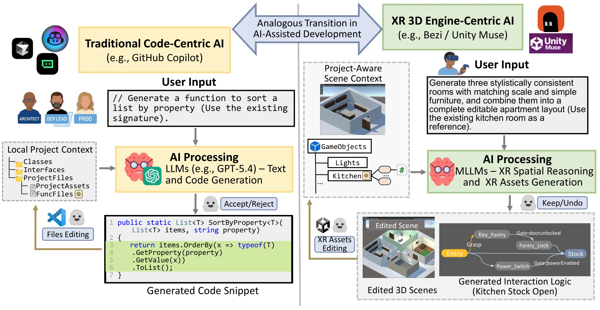

[English](README.md) · [中文](README.zh-CN.md)

# XR Software Engineering Survey

Software Engineering Practice in the Virtual Reality/Augmented Reality Software Life Cycle: A Systematic Survey

A systematic survey of software engineering across the VR/AR software life cycle, with curated papers, research insights and development resources.

[arXiv](https://arxiv.org/abs/2611.18567) · [Website](https://tsingpig.github.io/XR-Software-Engineering-Survey/) · [Paper library](https://tsingpig.github.io/XR-Software-Engineering-Survey/papers/)

Hanyang Guo, Jingwen Wu, Zhengyang Zhu, Gengyang Xu, Hong-Ning Dai, Xiapu Luo, Zibin Zheng



**117 papers · 7 life-cycle stages · 5 research themes**

## Insight-based reading lists

### [Spatial interaction reshapes engineering.](lists/spatial.md)

Six degrees of freedom, embodied input and comfort connect interface design to scene exploration and quality assurance.

- [VRExplorer: A Model-based Approach for Semi-Automated Testing of Virtual Reality Scenes](https://doi.org/10.1109/ASE63991.2025.00047)
- [Less Cybersickness, Please: Demystifying and Detecting Stereoscopic Visual Inconsistencies in Virtual Reality Apps](https://doi.org/10.1145/3660803)

### [AI assistance moves into the engine.](lists/ai.md)

Assistance spans scenes, assets, interaction logic and engine settings, making project context central to XR development.

- [GaussianShopVR: Facilitating Immersive 3D Authoring Using Gaussian Splatting in VR](https://doi.org/10.1145/3746059.3747803)
- [ImaginateAR: AI-Assisted In-Situ Authoring in Augmented Reality](https://doi.org/10.1145/3746059.3747635)

### [Immersion changes the attack surface.](lists/security.md)

Spatial interfaces and motion tracking connect software security to user perception, behavior and identity.

- [VPVet: Vetting Privacy Policies of Virtual Reality Apps](https://doi.org/10.1145/3658644.3690321)
- [Erebus: Access Control for Augmented Reality Systems](https://www.usenix.org/conference/usenixsecurity23/presentation/kim-yoonsang)

### [Maintenance crosses artifact boundaries.](lists/maintenance.md)

Performance problems and bad smells often require coordinated changes to scripts, 3D assets and engine configuration.

- [Analyzing Performance Issues of Virtual Reality Applications](https://arxiv.org/abs/2211.02013)
- [XRFix: Exploring Performance Bug Repair of Extended Reality Applications with Large Language Models](https://doi.org/10.1145/3744916.3773120)

### [Feedback connects quality to experience.](lists/evaluation.md)

Runtime measurements, experience studies and developer feedback create opportunities for scalable, human-centered quality assurance.

- [Extended Reality Cybersickness Assessment via User Review Analysis](https://doi.org/10.1145/3728933)
- [CreepyCoCreator? Investigating AI Representation Modes for 3D Object Co-Creation in Virtual Reality](https://doi.org/10.1145/3706598.3713720)

## Paper lists

- [Requirements & planning](#requirements) · 14
- [Software design](#design) · 22
- [Software development](#development) · 19
- [Software testing](#testing) · 20
- [Software deployment](#deployment) · 36
- [Maintenance & updates](#maintenance) · 7
- [Evaluation & feedback](#evaluation) · 8
- [Related surveys](#related) · 8

<a id="requirements"></a>

## Requirements & planning

Turn user needs and spatial constraints into implementable requirements.

### Requirement elicitation

| Year | Venue | Title | Key insight | Links |
| --- | --- | --- | --- | --- |
| 2024 | ACM IMWUT | [EStatiG: Wearable Haptic Feedback with Multi-Phalanx Electrostatic Brake for Enhanced Object Perception in VR](https://doi.org/10.1145/3678567) | Uses a multi-phalanx electrostatic brake to provide wearable haptic feedback for perceiving virtual objects. | [Paper](https://doi.org/10.1145/3678567) |
| 2024 | Heritage Science | [Gamification of virtual museum curation: a case study of Chinese bronze wares](https://doi.org/10.1186/s40494-024-01464-2) | Combines scanned bronze artifacts, immersive museum scenes and games to support cultural learning. | [Paper](https://doi.org/10.1186/s40494-024-01464-2) |
| 2024 | ACM IMWUT | [HapticPilot: Authoring In-situ Hand Posture-Adaptive Vibrotactile Feedback for Virtual Reality](https://doi.org/10.1145/3631453) | Supports authoring hand-posture-adaptive vibrotactile feedback for VR interactions. | [Paper](https://doi.org/10.1145/3631453) |
| 2023 | ISEC | [Requirements Elicitation for Virtual Reality Products - A Mapping Study](https://doi.org/10.1145/3578527.3578536) | Maps techniques and practices for eliciting requirements of VR products. | [Paper](https://doi.org/10.1145/3578527.3578536) |
| 2022 | ISMAR Adjunct | [VR4HcRE: Virtual Reality Platform for Human-centric Requirements Elicitation](https://doi.org/10.1109/ISMAR-Adjunct57072.2022.00168) | Provides a VR platform for human-centered requirements elicitation. | [Paper](https://doi.org/10.1109/ISMAR-Adjunct57072.2022.00168) |
| 2017 | AVR | [Virtual reality system for training in automotive mechanics](https://doi.org/10.1007/978-3-319-60922-5_14) | Builds a VR automotive mechanics training system around practical maintenance tasks. | [Paper](https://doi.org/10.1007/978-3-319-60922-5_14) |

### Requirement analysis

| Year | Venue | Title | Key insight | Links |
| --- | --- | --- | --- | --- |
| 2024 | ACM IMWUT | [Examining Psychological Conflict-Handling Strategies for Highly Automated Vehicles to Resolve Legal User-Vehicle Conflicts](https://doi.org/10.1145/3678511) | Studies persuasive conflict-handling strategies in a VR driving simulator for highly automated vehicles. | [Paper](https://doi.org/10.1145/3678511) |
| 2024 | MODELS | [M2AR: A Web-based Modeling Environment for the Augmented Reality Workflow Modeling Language](https://doi.org/10.1145/3652620.3687779) | Provides a web modeling environment for specifying AR application workflows. | [Paper](https://doi.org/10.1145/3652620.3687779) |
| 2024 | ACM TOSEM | [RE Methods for Virtual Reality Software Product Development: A Mapping Study](https://doi.org/10.1145/3649595) | Maps requirements engineering methods used in VR software product development. | [Paper](https://doi.org/10.1145/3649595) |
| 2022 | ASE | [A Role Based Model Template for Specifying Virtual Reality Software](https://doi.org/10.1145/3551349.3560514) | Introduces a role-based metamodel for specifying the core elements of VR software systems. | [Paper](https://doi.org/10.1145/3551349.3560514) |
| 2018 | ACM PACMHCI (CSCW) | [UMI3D: A Unity3D Toolbox to Support CSCW Systems Properties in Generic 3D User Interfaces](https://doi.org/10.1145/3274298) | Offers a Unity toolbox for generic 3D interfaces that support collaborative work. | [Paper](https://doi.org/10.1145/3274298) |

### Requirement specification

| Year | Venue | Title | Key insight | Links |
| --- | --- | --- | --- | --- |
| 2025 | ICSE Companion | [VReqST: A Requirement Specification Tool for Virtual Reality Software Products](https://doi.org/10.1109/ICSE-Companion66252.2025.00012) | Provides a requirements specification tool tailored to VR software products. | [Paper](https://doi.org/10.1109/ICSE-Companion66252.2025.00012) |
| 2022 | ASE | [A Role Based Model Template for Specifying Virtual Reality Software](https://doi.org/10.1145/3551349.3560514) | Introduces a role-based metamodel for specifying the core elements of VR software systems. | [Paper](https://doi.org/10.1145/3551349.3560514) |

### Validation & management

| Year | Venue | Title | Key insight | Links |
| --- | --- | --- | --- | --- |
| 2021 | Advances in Engineering Software | [Distributed Microscopic Traffic Simulation with Human-in-the-Loop Enabled by Virtual Reality Technologies](https://doi.org/10.1016/j.advengsoft.2021.102985) | Integrates VR human participation with distributed microscopic traffic simulation. | [Paper](https://doi.org/10.1016/j.advengsoft.2021.102985) |
| 2019 | CHI | [360proto: Making Interactive Virtual Reality & Augmented Reality Prototypes from Paper](https://doi.org/10.1145/3290605.3300826) | Turns paper sketches into interactive VR and AR prototypes for rapid experience validation. | [Paper](https://doi.org/10.1145/3290605.3300826) |

<a id="design"></a>

## Software design

Design interactions around 3D space, body movement and human comfort.

### Sketching

| Year | Venue | Title | Key insight | Links |
| --- | --- | --- | --- | --- |
| 2021 | Mindtrek | [Immersive Video Sketching: Low-Fidelity Extended Reality Prototyping for Everyone](https://doi.org/10.1145/3464327.3464330) | Uses immersive video sketching to create accessible, low-fidelity XR experience prototypes. | [Paper](https://doi.org/10.1145/3464327.3464330) |
| 2020 | CHI | [VRSketchIn: Exploring the Design Space of Pen and Tablet Interaction for 3D Sketching in Virtual Reality](https://doi.org/10.1145/3313831.3376628) | Explores pen-and-tablet interaction techniques for 3D sketching in VR. | [Paper](https://doi.org/10.1145/3313831.3376628) |
| 2019 | CHI EA | [What You Sketch Is What You Get: Quick and Easy Augmented Reality Prototyping with PintAR](https://doi.org/10.1145/3290607.3312847) | Lets designers sketch with a digital pen and interact with the resulting AR prototypes. | [Paper](https://doi.org/10.1145/3290607.3312847) |
| 2012 | Personal and Ubiquitous Computing | [Sketching up the World: In Situ Authoring for Mobile Augmented Reality](https://doi.org/10.1007/s00779-011-0430-0) | Enables smartphone users to sketch and create mobile AR content in its physical context. | [Paper](https://doi.org/10.1007/s00779-011-0430-0) |
| 2010 | IEEE VR | [In-Place Sketching for Content Authoring in Augmented Reality Games](https://doi.org/10.1109/VR.2010.5444806) | Explores in-place sketching as a visual language for authoring AR game content. | [Paper](https://doi.org/10.1109/VR.2010.5444806) |

### 3D interaction

| Year | Venue | Title | Key insight | Links |
| --- | --- | --- | --- | --- |
| 2025 | CHI | [Exploring the Design Space of Privacy-Driven Adaptation Techniques for Future Augmented Reality Interfaces](https://doi.org/10.1145/3706598.3713320) | Explores interface adaptation techniques that respond to privacy needs in AR. | [Paper](https://doi.org/10.1145/3706598.3713320) |
| 2022 | CHI | [Elements of XR Prototyping: Characterizing the Role and Use of Prototypes in Augmented and Virtual Reality Design](https://doi.org/10.1145/3491102.3517714) | Characterizes how prototypes support design work across AR and VR projects. | [Paper](https://doi.org/10.1145/3491102.3517714) |
| 2021 | CHI | [Current practices, challenges, and design implications for collaborative AR/VR application development](https://doi.org/10.1145/3411764.3445335) | Interviews AR/VR professionals to identify development roles, collaboration challenges and tool needs. | [Paper](https://doi.org/10.1145/3411764.3445335) |
| 2021 | VRST | [Research and Practice Recommendations for Mixed Reality Design – Different Perspectives from the Community](https://doi.org/10.1145/3489849.3489876) | Collects community perspectives to derive mixed reality design and research recommendations. | [Paper](https://doi.org/10.1145/3489849.3489876) |
| 2020 | HORA | [Modern Virtual Reality Headsets](https://doi.org/10.1109/HORA49412.2020.9152604) | Reviews modern VR headsets and their characteristics for immersive interaction. | [Paper](https://doi.org/10.1109/HORA49412.2020.9152604) |
| 1995 | CHI | [Virtual reality on a WIM: interactive worlds in miniature](https://doi.org/10.1145/223904.223938) | Introduces worlds-in-miniature for viewing and manipulating a virtual environment through a small-scale representation. | [Paper](https://doi.org/10.1145/223904.223938) |

### Storyboarding

| Year | Venue | Title | Key insight | Links |
| --- | --- | --- | --- | --- |
| 2024 | INTETAIN | [A Novel Approach to 3D Storyboarding](https://doi.org/10.1007/978-3-031-55722-4_13) | Creates storyboards from 3D scenes, actor actions, camera settings and generated scene descriptions. | [Paper](https://doi.org/10.1007/978-3-031-55722-4_13) |
| 2022 | ACM PACMHCI (EICS) | [Software Engineering for Augmented Reality - A Research Agenda](https://doi.org/10.1145/3532205) | Reviews software engineering for AR and develops a research agenda for its methods and tools. | [Paper](https://doi.org/10.1145/3532205) |

### User experience, comfort & haptics

| Year | Venue | Title | Key insight | Links |
| --- | --- | --- | --- | --- |
| 2022 | Frontiers in Virtual Reality | [Effects of simulated augmented reality cueing in a virtual navigation task](https://doi.org/10.3389/frvir.2022.971310) | Evaluates AR-style navigation cues through spatial learning, cognitive load and situational awareness in VR. | [Paper](https://doi.org/10.3389/frvir.2022.971310) |
| 2020 | CVPR | [3D Photography Using Context-Aware Layered Depth Inpainting](https://openaccess.thecvf.com/content_CVPR_2020/html/Shih_3D_Photography_Using_Context-Aware_Layered_Depth_Inpainting_CVPR_2020_paper.html) | Converts RGB-D images into layered 3D photos through context-aware color and depth inpainting. | [Paper](https://openaccess.thecvf.com/content_CVPR_2020/html/Shih_3D_Photography_Using_Context-Aware_Layered_Depth_Inpainting_CVPR_2020_paper.html) · [arXiv](https://arxiv.org/abs/2004.04727) · [Project](https://shihmengli.github.io/3D-Photo-Inpainting/) |
| 2020 | Virtual Reality | [Effects of steering locomotion and teleporting on cybersickness and presence in HMD-based virtual reality](https://doi.org/10.1007/s10055-019-00407-8) | Compares steering and teleportation locomotion through cybersickness and presence measurements. | [Paper](https://doi.org/10.1007/s10055-019-00407-8) |
| 2020 | CHI | [WalkingVibe: Reducing Virtual Reality Sickness and Improving Realism while Walking in VR using Unobtrusive Head-mounted Vibrotactile Feedback](https://doi.org/10.1145/3313831.3376847) | Studies head-mounted vibrotactile feedback for reducing sickness and improving walking realism in VR. | [Paper](https://doi.org/10.1145/3313831.3376847) |
| 2019 | International Journal of Emerging Technologies in Learning | [Augmented Reality and Virtual Reality in Education. Myth or Reality?](https://doi.org/10.3991/ijet.v14i03.9289) | Discusses AR and VR adoption in education and the opportunities for immersive learning. | [Paper](https://doi.org/10.3991/ijet.v14i03.9289) |
| 2017 | Experimental Brain Research | [The virtual reality head-mounted display Oculus Rift induces motion sickness and is sexist in its effects](https://doi.org/10.1007/s00221-016-4846-7) | Measures motion sickness and postural responses during Oculus Rift gameplay. | [Paper](https://doi.org/10.1007/s00221-016-4846-7) |
| 2016 | Virtual Reality | [Review on cybersickness in applications and visual displays](https://doi.org/10.1007/s10055-016-0285-9) | Reviews cybersickness factors, measurement approaches and mitigation across immersive applications and visual displays. | [Paper](https://doi.org/10.1007/s10055-016-0285-9) |
| 2002 | Applied Ergonomics | [Health and safety implications of virtual reality: a review of empirical evidence](https://doi.org/10.1016/S0003-6870(02)00020-0) | Reviews empirical evidence on health and safety effects associated with VR use. | [Paper](https://doi.org/10.1016/S0003-6870(02)00020-0) |
| 2000 | ACM SIGCHI Bulletin | [A discussion of cybersickness in virtual environments](https://doi.org/10.1145/333329.333344) | Discusses causes, symptoms and mitigation approaches for cybersickness in virtual environments. | [Paper](https://doi.org/10.1145/333329.333344) |

<a id="development"></a>

## Software development

Build scenes, assets and interaction logic inside immersive development workflows.

### Frameworks & immersive environments

| Year | Venue | Title | Key insight | Links |
| --- | --- | --- | --- | --- |
| 2025 | IDE @ ICSE | [Code Refactoring in Virtual Reality](https://doi.org/10.1109/IDE66625.2025.00006) | Explores code refactoring inside VR through spatial program visualization and controller interactions. | [Paper](https://doi.org/10.1109/IDE66625.2025.00006) |
| 2025 | UIST | [GaussianShopVR: Facilitating Immersive 3D Authoring Using Gaussian Splatting in VR](https://doi.org/10.1145/3746059.3747803) | Supports immersive editing and authoring of 3D Gaussian splatting content in VR. | [Paper](https://doi.org/10.1145/3746059.3747803) |
| 2025 | UIST | [ImaginateAR: AI-Assisted In-Situ Authoring in Augmented Reality](https://doi.org/10.1145/3746059.3747635) | Combines scene understanding, generated 3D assets and speech interaction for in-situ AR authoring. | [Paper](https://doi.org/10.1145/3746059.3747635) · [arXiv](https://arxiv.org/abs/2504.21360) |
| 2025 | UIST Adjunct | [RealityCrafter: User-guided Editable 3D Scene Generation from a Single Image in Mixed Reality](https://doi.org/10.1145/3746058.3758405) | Generates editable mixed reality scenes from one image with user guidance. | [Paper](https://doi.org/10.1145/3746058.3758405) |
| 2025 | CHI | [RemapVR: An Immersive Authoring Tool for Rapid Prototyping of Remapped Interaction in VR](https://doi.org/10.1145/3706598.3714201) | Provides an immersive authoring tool for prototyping and inspecting remapped VR interactions. | [Paper](https://doi.org/10.1145/3706598.3714201) |
| 2022 | ICECAA | [Analysis of Virtual Reality and Augmented Reality SDK’s and Game Engines: A Comparison](https://doi.org/10.1109/ICECAA55415.2022.9936111) | Compares VR and AR SDKs and game engines for application development. | [Paper](https://doi.org/10.1109/ICECAA55415.2022.9936111) |
| 2022 | USENIX Security | [OVRseen: Auditing Network Traffic and Privacy Policies in Oculus VR](https://www.usenix.org/conference/usenixsecurity22/presentation/trimananda) | Audits Oculus VR network traffic against privacy policies to examine data collection and disclosure. | [Paper](https://www.usenix.org/conference/usenixsecurity22/presentation/trimananda) |
| 2021 | ICPC | [Automatic Extraction of Code Dependency in Virtual Reality Software](https://doi.org/10.1109/ICPC52881.2021.00043) | Extracts code dependencies from VR software to support program understanding. | [Paper](https://doi.org/10.1109/ICPC52881.2021.00043) |
| 2020 | ISCV | [ARKit and ARCore in serve to augmented reality](https://doi.org/10.1109/ISCV49265.2020.9204243) | Examines ARKit and ARCore as platforms for building augmented reality applications. | [Paper](https://doi.org/10.1109/ISCV49265.2020.9204243) |
| 2018 | QRS | [The State of Practice on Virtual Reality (VR) Applications: An Exploratory Study on Github and Stack Overflow](https://doi.org/10.1109/QRS.2018.00048) | Studies VR application development practices through GitHub projects and Stack Overflow discussions. | [Paper](https://doi.org/10.1109/QRS.2018.00048) |

### Interaction implementation

| Year | Venue | Title | Key insight | Links |
| --- | --- | --- | --- | --- |
| 2025 | UIST | [ImaginateAR: AI-Assisted In-Situ Authoring in Augmented Reality](https://doi.org/10.1145/3746059.3747635) | Combines scene understanding, generated 3D assets and speech interaction for in-situ AR authoring. | [Paper](https://doi.org/10.1145/3746059.3747635) · [arXiv](https://arxiv.org/abs/2504.21360) |
| 2025 | UIST Adjunct | [RealityCrafter: User-guided Editable 3D Scene Generation from a Single Image in Mixed Reality](https://doi.org/10.1145/3746058.3758405) | Generates editable mixed reality scenes from one image with user guidance. | [Paper](https://doi.org/10.1145/3746058.3758405) |
| 2025 | CHI | [RemapVR: An Immersive Authoring Tool for Rapid Prototyping of Remapped Interaction in VR](https://doi.org/10.1145/3706598.3714201) | Provides an immersive authoring tool for prototyping and inspecting remapped VR interactions. | [Paper](https://doi.org/10.1145/3706598.3714201) |
| 2022 | ACM TOPS | [Hidden in Plain Sight: Exploring Privacy Risks of Mobile Augmented Reality Applications](https://doi.org/10.1145/3524020) | Examines hidden operations in mobile AR and develops defenses against privacy-invasive interactions. | [Paper](https://doi.org/10.1145/3524020) |
| 2022 | IEEE VR Workshops | [Reality Check of Metaverse: A First Look at Commercial Social Virtual Reality Platforms](https://doi.org/10.1109/VRW55335.2022.00040) | Measures commercial social VR networking to characterize multimedia delivery, protocol use and bandwidth demands. | [Paper](https://doi.org/10.1109/VRW55335.2022.00040) |
| 2022 | IEEE Network | [Will Metaverse Be NextG Internet? Vision, Hype, and Reality](https://doi.org/10.1109/MNET.117.2200055) | Compares commercial metaverse platforms to connect network performance with deployment requirements and future infrastructure. | [Paper](https://doi.org/10.1109/MNET.117.2200055) |

### Performance, QoS & QoE

| Year | Venue | Title | Key insight | Links |
| --- | --- | --- | --- | --- |
| 2024 | Multimedia Tools and Applications | [Content format and quality of experience in virtual reality](https://doi.org/10.1007/s11042-022-12176-9) | Examines how VR content formats influence the quality of immersive viewing experiences. | [Paper](https://doi.org/10.1007/s11042-022-12176-9) |
| 2024 | Applied Sciences | [Impact of Latency on QoE, Performance, and Collaboration in Interactive Multi-User Virtual Reality](https://www.mdpi.com/2076-3417/14/6/2290) | Studies how network latency affects experience, task performance and collaboration in multi-user VR. | [Paper](https://www.mdpi.com/2076-3417/14/6/2290) · [DOI](https://doi.org/10.3390/app14062290) |
| 2022 | arXiv | [Analyzing Performance Issues of Virtual Reality Applications](https://arxiv.org/abs/2211.02013) | Derives Unreal Engine performance bug patterns and detects performance bugs in configuration files and C++ code. | [Paper](https://arxiv.org/abs/2211.02013) |
| 2021 | ICSE | [How Developers Optimize Virtual Reality Applications: A Study of Optimization Commits in Open Source Unity Projects](https://doi.org/10.1109/ICSE43902.2021.00052) | Classifies real-world Unity VR optimizations across graphics, rendering and memory management. | [Paper](https://doi.org/10.1109/ICSE43902.2021.00052) |
| 2020 | ProQuest Dissertations and Theses | [An Empirical Analysis of Unity Performance Bugs](https://www.proquest.com/dissertations-theses/empirical-analysis-unity-performance-bugs/docview/2447297064/se-2) | Analyzes Unity performance fixes to connect source-code changes with prefab and asset modifications. | [Paper](https://www.proquest.com/dissertations-theses/empirical-analysis-unity-performance-bugs/docview/2447297064/se-2) |
| 2020 | MSR | [Detecting Video Game-Specific Bad Smells in Unity Projects](https://doi.org/10.1145/3379597.3387454) | Introduces UnityLinter to detect game-specific performance, maintainability and behavioral smells. | [Paper](https://doi.org/10.1145/3379597.3387454) |

<a id="testing"></a>

## Software testing

Explore scenes and test functional behavior, visual quality and usability.

### Bugs & test smells

| Year | Venue | Title | Key insight | Links |
| --- | --- | --- | --- | --- |
| 2025 | ASE | [VRTestSniffer: Test Smell Detector for Virtual Reality (VR) Software Projects](https://doi.org/10.1109/ASE63991.2025.00163) | Detects VR-specific test smells using syntax, control-flow and data-flow analysis of Unity tests. | [Paper](https://doi.org/10.1109/ASE63991.2025.00163) · [Code](https://github.com/smilevo/VRTestSniffer) |
| 2021 | ICSE | [How Developers Optimize Virtual Reality Applications: A Study of Optimization Commits in Open Source Unity Projects](https://doi.org/10.1109/ICSE43902.2021.00052) | Classifies real-world Unity VR optimizations across graphics, rendering and memory management. | [Paper](https://doi.org/10.1109/ICSE43902.2021.00052) |
| 2020 | ISSRE | [An Exploratory Study of Bugs in Extended Reality Applications on the Web](https://doi.org/10.1109/ISSRE5003.2020.00025) | Builds a WebXR bug taxonomy covering device incompatibility, interaction handling and application failures. | [Paper](https://doi.org/10.1109/ISSRE5003.2020.00025) |

### Functional testing

| Year | Venue | Title | Key insight | Links |
| --- | --- | --- | --- | --- |
| 2025 | ASE Workshops | [A Test Automation Framework for User Interaction in Extended Reality Applications](https://doi.org/10.1109/ASEW67777.2025.00066) | Introduces INTENXION APIs to simulate compositional XR interactions and assert expected outcomes. | [Paper](https://doi.org/10.1109/ASEW67777.2025.00066) |
| 2023 | ISSTA | [Virtual Reality (VR) Automated Testing in the Wild: A Case Study on Unity-Based VR Applications](https://doi.org/10.1145/3597926.3598134) | Characterizes automated testing practices and test categories across open-source Unity VR applications. | [Paper](https://doi.org/10.1145/3597926.3598134) |
| 2018 | Software Testing, Verification and Reliability | [An automated functional testing approach for virtual reality applications](https://doi.org/10.1002/stvr.1690) | Generates functional test requirements and data from semiformal specifications of VR behavior. | [Paper](https://doi.org/10.1002/stvr.1690) |

### GUI & visual testing

| Year | Venue | Title | Key insight | Links |
| --- | --- | --- | --- | --- |
| 2025 | ASE | [VRExplorer: A Model-based Approach for Semi-Automated Testing of Virtual Reality Scenes](https://doi.org/10.1109/ASE63991.2025.00047) | Models entities, actions and tasks to guide navigation and diverse interactions during VR testing. | [Paper](https://doi.org/10.1109/ASE63991.2025.00047) · [arXiv](https://arxiv.org/abs/2607.10174) · [Code](https://github.com/TsingPig/VRExplorer_Release) |
| 2024 | FSE | [Less Cybersickness, Please: Demystifying and Detecting Stereoscopic Visual Inconsistencies in Virtual Reality Apps](https://doi.org/10.1145/3660803) | Introduces StereoID to detect stereoscopic visual inconsistencies from rendered left- and right-eye images. | [Paper](https://doi.org/10.1145/3660803) · [arXiv](https://arxiv.org/abs/2406.09313) |
| 2023 | ISSTA | [Virtual Reality (VR) Automated Testing in the Wild: A Case Study on Unity-Based VR Applications](https://doi.org/10.1145/3597926.3598134) | Characterizes automated testing practices and test categories across open-source Unity VR applications. | [Paper](https://doi.org/10.1145/3597926.3598134) |
| 2023 | ASE | [VRGuide: Efficient Testing of Virtual Reality Scenes via Dynamic Cut Coverage](https://doi.org/10.1109/ASE56229.2023.00197) | Uses dynamic cut coverage to guide camera movement and improve exploration of VR scenes. | [Paper](https://doi.org/10.1109/ASE56229.2023.00197) |
| 2022 | ICSE Companion | [VRTest: An extensible framework for automatic testing of virtual reality scenes](https://doi.org/10.1109/ICSE-Companion55297.2022.9793753) | Automates VR scene exploration through camera control and random or greedy interaction strategies. | [Paper](https://doi.org/10.1109/ICSE-Companion55297.2022.9793753) |

### Usability testing

| Year | Venue | Title | Key insight | Links |
| --- | --- | --- | --- | --- |
| 2024 | FSE | [Less Cybersickness, Please: Demystifying and Detecting Stereoscopic Visual Inconsistencies in Virtual Reality Apps](https://doi.org/10.1145/3660803) | Introduces StereoID to detect stereoscopic visual inconsistencies from rendered left- and right-eye images. | [Paper](https://doi.org/10.1145/3660803) · [arXiv](https://arxiv.org/abs/2406.09313) |
| 2024 | ISSTA | [Towards Automatic Oracle Prediction for AR Testing: Assessing Virtual Object Placement Quality under Real-World Scenes](https://doi.org/10.1145/3650212.3680315) | Combines scene metadata and learned image analysis to detect imprecise AR object placements. | [Paper](https://doi.org/10.1145/3650212.3680315) |
| 2022 | ASE | [PredART: Towards automatic oracle prediction of object placements in augmented reality testing](https://doi.org/10.1145/3551349.3561160) | Predicts human judgments of virtual object placement to automate AR usability oracles. | [Paper](https://doi.org/10.1145/3551349.3561160) |
| 2020 | ICST | [Agent-based testing of extended reality systems](https://doi.org/10.1109/ICST46399.2020.00051) | Combines autonomous cognitive test agents with emotion modeling to assess XR behavior and user experience. | [Paper](https://doi.org/10.1109/ICST46399.2020.00051) |
| 2020 | IEEE VR | [ARCHIE: A user-focused framework for testing augmented reality applications in the wild](https://doi.org/10.1109/VR46266.2020.00013) | Connects user feedback with runtime telemetry to diagnose AR performance and usability problems. | [Paper](https://doi.org/10.1109/VR46266.2020.00013) |
| 2018 | IEEE CIG | [A virtual agent toolkit for serious games developers](https://doi.org/10.1109/CIG.2018.8490399) | Provides the FAtiMA toolkit for authoring virtual agents with emotional and social behavior. | [Paper](https://doi.org/10.1109/CIG.2018.8490399) |

### Security testing

| Year | Venue | Title | Key insight | Links |
| --- | --- | --- | --- | --- |
| 2023 | USENIX Security | [A peek into the metaverse: detecting 3D model clones in mobile games](https://www.usenix.org/conference/usenixsecurity23/presentation/zuo) | Detects static and animated 3D model clones in Unity mobile games through normalized asset comparison. | [Paper](https://www.usenix.org/conference/usenixsecurity23/presentation/zuo) |

### Testing tools

| Year | Venue | Title | Key insight | Links |
| --- | --- | --- | --- | --- |
| 2026 | Automated Software Engineering | [Harnessing large language models for virtual reality exploration testing: a case study](https://doi.org/10.1007/s10515-025-00535-3) | Evaluates LLM entity detection, feature descriptions and spatial reasoning for black-box VR exploration testing. | [Paper](https://doi.org/10.1007/s10515-025-00535-3) · [Code](https://github.com/qzydustin/LLM4VR) |
| 2024 | arXiv | [Grounded GUI Understanding for Vision Based Spatial Intelligent Agent: Exemplified by Virtual Reality Apps](https://arxiv.org/abs/2409.10811) | Introduces Orienter to ground context-sensitive interactable GUI elements in VR scenes with multimodal models. | [Paper](https://arxiv.org/abs/2409.10811) |
| 2024 | ASE Workshops | [Utilizing Generative AI for VR Exploration Testing: A Case Study](https://doi.org/10.1145/3691621.3694955) | Studies generative AI for identifying test entities and spatial features from VR field-of-view images. | [Paper](https://doi.org/10.1145/3691621.3694955) |
| 2022 | ASE | [DyTRec: A Dynamic Testing Recommendation tool for Unity-based Virtual Reality Software](https://doi.org/10.1145/3551349.3560510) | Recommends dynamic test types by analyzing Unity APIs and their use in VR source code. | [Paper](https://doi.org/10.1145/3551349.3560510) |

<a id="deployment"></a>

## Software deployment

Distribute XR software and protect immersive interfaces and behavioral data.

### Distribution platforms

| Year | Venue | Title | Key insight | Links |
| --- | --- | --- | --- | --- |
| 2026 | IEEE Transactions on Networking | [Vetting Privacy Policies in Virtual Reality Platforms With Longitudinal Analysis](https://doi.org/10.1109/TON.2025.3618730) | Tracks VR platform privacy policies over time to analyze policy quality and longitudinal changes. | [Paper](https://doi.org/10.1109/TON.2025.3618730) |
| 2024 | IEEE Security & Privacy | [Understanding Privacy in Virtual Reality Classrooms: A Contextual Integrity Perspective](https://doi.org/10.1109/MSEC.2023.3336802) | Analyzes information flows in VR classrooms through contextual integrity and context-dependent privacy expectations. | [Paper](https://doi.org/10.1109/MSEC.2023.3336802) |
| 2024 | CCS | [VPVet: Vetting Privacy Policies of Virtual Reality Apps](https://doi.org/10.1145/3658644.3690321) | Introduces VPVet to analyze VR privacy policies for collection granularity, minimization and statement consistency. | [Paper](https://doi.org/10.1145/3658644.3690321) · [arXiv](https://arxiv.org/abs/2409.00740) · [Code](https://github.com/kalamoo/PPAudit) |
| 2022 | ASE | [A Study of User Privacy in Android Mobile AR Apps](https://doi.org/10.1145/3551349.3560512) | Examines user privacy practices and data handling in Android mobile AR applications. | [Paper](https://doi.org/10.1145/3551349.3560512) |
| 2022 | IEEE Transactions on Games | [Beyond Genre: Classifying Virtual Reality Experiences](https://doi.org/10.1109/TG.2021.3119521) | Classifies VR experiences beyond conventional game genres to support platform discovery and comparison. | [Paper](https://doi.org/10.1109/TG.2021.3119521) |
| 2022 | USENIX Security | [OVRseen: Auditing Network Traffic and Privacy Policies in Oculus VR](https://www.usenix.org/conference/usenixsecurity22/presentation/trimananda) | Audits Oculus VR network traffic against privacy policies to examine data collection and disclosure. | [Paper](https://www.usenix.org/conference/usenixsecurity22/presentation/trimananda) |

### Version control & updates

| Year | Venue | Title | Key insight | Links |
| --- | --- | --- | --- | --- |
| 2026 | ICSE | [XRFix: Exploring Performance Bug Repair of Extended Reality Applications with Large Language Models](https://doi.org/10.1145/3744916.3773120) | Introduces XRFix to generate and validate performance-bug repairs for XR applications with LLMs. | [Paper](https://doi.org/10.1145/3744916.3773120) · [arXiv](https://arxiv.org/abs/2608.21718) · [Code](https://github.com/wwwjwww/XRFix) |
| 2025 | CCS | [Virtual Reality, Real Problems: A Longitudinal Security Analysis of VR Firmware](https://doi.org/10.1145/3719027.3765102) | Tracks VR firmware evolution to identify security weaknesses and the persistence of vulnerable components. | [Paper](https://doi.org/10.1145/3719027.3765102) |

### Immersive interface security

| Year | Venue | Title | Key insight | Links |
| --- | --- | --- | --- | --- |
| 2025 | CCS | [PipID: Light-Pupillary Response Based User Authentication for Virtual Reality](https://doi.org/10.1145/3719027.3744850) | Uses light-induced pupillary responses to authenticate users within VR headsets. | [Paper](https://doi.org/10.1145/3719027.3744850) |
| 2025 | EASE | [SecCityVR: Visualization and Collaborative Exploration of Software Vulnerabilities in Virtual Reality](https://doi.org/10.1145/3756681.3756939) | Uses a collaborative VR city visualization to explore software vulnerabilities and their relationships. | [Paper](https://doi.org/10.1145/3756681.3756939) |
| 2025 | USENIX Security | [Shadowed Realities: An Investigation of UI Attacks in WebXR](https://www.usenix.org/conference/usenixsecurity25/presentation/mukherjee) | Analyzes WebXR UI attacks and measures how dark designs influence immersive user behavior. | [Paper](https://www.usenix.org/conference/usenixsecurity25/presentation/mukherjee) |
| 2025 | USENIX Security | [SoK: Come Together – Unifying Security, Information Theory, and Cognition for a Mixed Reality Deception Attack Ontology & Analysis Framework](https://www.usenix.org/conference/usenixsecurity25/presentation/teymourian) | Unifies security, information theory and cognition in an ontology and analysis framework for MR deception attacks. | [Paper](https://www.usenix.org/conference/usenixsecurity25/presentation/teymourian) |
| 2024 | arXiv | [Inception Attacks: Immersive Hijacking in Virtual Reality Systems](https://arxiv.org/abs/2403.05721) | Demonstrates immersive hijacking by trapping users inside an application that impersonates the VR system interface. | [Paper](https://arxiv.org/abs/2403.05721) |
| 2024 | USENIX Security | [That doesn’t go there: attacks on shared state in Multi-User augmented reality applications](https://www.usenix.org/conference/usenixsecurity24/presentation/slocum) | Shows how manipulated shared state compromises multi-user AR interactions and virtual content. | [Paper](https://www.usenix.org/conference/usenixsecurity24/presentation/slocum) |
| 2024 | CCS | [The Big Brother’s New Playground: Unmasking the Illusion of Privacy in Web Metaverses from a Malicious User’s Perspective](https://doi.org/10.1145/3658644.3690249) | Exploits browser-side metaverse objects to study surveillance, tracking and privacy leakage by malicious users. | [Paper](https://doi.org/10.1145/3658644.3690249) |
| 2024 | USENIX Security | [When the User Is Inside the User Interface: An Empirical Study of UI Security Properties in Augmented Reality](https://www.usenix.org/conference/usenixsecurity24/presentation/cheng-kaiming) | Examines AR UI security properties through platform measurements and proof-of-concept interface attacks. | [Paper](https://www.usenix.org/conference/usenixsecurity24/presentation/cheng-kaiming) |
| 2023 | USENIX Security | [Erebus: Access Control for Augmented Reality Systems](https://www.usenix.org/conference/usenixsecurity23/presentation/kim-yoonsang) | Introduces Erebus for fine-grained, context-aware access control over AR sensing data. | [Paper](https://www.usenix.org/conference/usenixsecurity23/presentation/kim-yoonsang) · [Code](https://github.com/Ethos-lab/erebus-AR_access_control) |
| 2023 | PoPETs | [Exploring the Privacy Risks of Adversarial VR Game Design](https://doi.org/10.56553/popets-2023-0108) | Uses adversarial VR game design to investigate sensitive information exposed through gameplay and movement. | [Paper](https://doi.org/10.56553/popets-2023-0108) |
| 2023 | USENIX Security | [It’s all in your head(set): side-channel attacks on AR/VR systems](https://www.usenix.org/conference/usenixsecurity23/presentation/zhang-yicheng) | Demonstrates malware-driven side channels that infer AR/VR gestures, voice commands and virtual keystrokes. | [Paper](https://www.usenix.org/conference/usenixsecurity23/presentation/zhang-yicheng) |
| 2022 | ACM TOPS | [Hidden in Plain Sight: Exploring Privacy Risks of Mobile Augmented Reality Applications](https://doi.org/10.1145/3524020) | Examines hidden operations in mobile AR and develops defenses against privacy-invasive interactions. | [Paper](https://doi.org/10.1145/3524020) |
| 2022 | IEEE TDSC | [Modeling and Defense of Social Virtual Reality Attacks Inducing Cybersickness](https://doi.org/10.1109/TDSC.2021.3121216) | Models attacks that induce cybersickness in social VR and evaluates defenses with attack-fault trees. | [Paper](https://doi.org/10.1109/TDSC.2021.3121216) |
| 2022 | USENIX Security | [Playing Without Paying: Detecting Vulnerable Payment Verification in Native Binaries of Unity Mobile Games](https://www.usenix.org/conference/usenixsecurity22/presentation/zuo) | Analyzes native Unity game binaries to detect vulnerable in-app payment verification. | [Paper](https://www.usenix.org/conference/usenixsecurity22/presentation/zuo) |
| 2021 | USENIX Security | [AdCube: WebVR Ad Fraud and Practical Confinement of Third-Party Ads](https://www.usenix.org/conference/usenixsecurity21/presentation/lee-hyunjoo) | Exposes WebVR advertising fraud and designs confinement mechanisms for third-party immersive advertisements. | [Paper](https://www.usenix.org/conference/usenixsecurity21/presentation/lee-hyunjoo) |
| 2019 | USENIX Security | [Secure Multi-User Content Sharing for Augmented Reality Applications](https://www.usenix.org/conference/usenixsecurity19/presentation/ruth) | Defines secure multi-user AR content sharing with permissions grounded in physical and virtual context. | [Paper](https://www.usenix.org/conference/usenixsecurity19/presentation/ruth) |

### Privacy & side channels

| Year | Venue | Title | Key insight | Links |
| --- | --- | --- | --- | --- |
| 2026 | IEEE Transactions on Networking | [Vetting Privacy Policies in Virtual Reality Platforms With Longitudinal Analysis](https://doi.org/10.1109/TON.2025.3618730) | Tracks VR platform privacy policies over time to analyze policy quality and longitudinal changes. | [Paper](https://doi.org/10.1109/TON.2025.3618730) |
| 2025 | CCS | [PipID: Light-Pupillary Response Based User Authentication for Virtual Reality](https://doi.org/10.1145/3719027.3744850) | Uses light-induced pupillary responses to authenticate users within VR headsets. | [Paper](https://doi.org/10.1145/3719027.3744850) |
| 2024 | CCS | [The Big Brother’s New Playground: Unmasking the Illusion of Privacy in Web Metaverses from a Malicious User’s Perspective](https://doi.org/10.1145/3658644.3690249) | Exploits browser-side metaverse objects to study surveillance, tracking and privacy leakage by malicious users. | [Paper](https://doi.org/10.1145/3658644.3690249) |
| 2024 | CCS | [VPVet: Vetting Privacy Policies of Virtual Reality Apps](https://doi.org/10.1145/3658644.3690321) | Introduces VPVet to analyze VR privacy policies for collection granularity, minimization and statement consistency. | [Paper](https://doi.org/10.1145/3658644.3690321) · [arXiv](https://arxiv.org/abs/2409.00740) · [Code](https://github.com/kalamoo/PPAudit) |
| 2023 | USENIX Security | [Erebus: Access Control for Augmented Reality Systems](https://www.usenix.org/conference/usenixsecurity23/presentation/kim-yoonsang) | Introduces Erebus for fine-grained, context-aware access control over AR sensing data. | [Paper](https://www.usenix.org/conference/usenixsecurity23/presentation/kim-yoonsang) · [Code](https://github.com/Ethos-lab/erebus-AR_access_control) |
| 2023 | PoPETs | [Exploring the Privacy Risks of Adversarial VR Game Design](https://doi.org/10.56553/popets-2023-0108) | Uses adversarial VR game design to investigate sensitive information exposed through gameplay and movement. | [Paper](https://doi.org/10.56553/popets-2023-0108) |
| 2023 | USENIX Security | [It’s all in your head(set): side-channel attacks on AR/VR systems](https://www.usenix.org/conference/usenixsecurity23/presentation/zhang-yicheng) | Demonstrates malware-driven side channels that infer AR/VR gestures, voice commands and virtual keystrokes. | [Paper](https://www.usenix.org/conference/usenixsecurity23/presentation/zhang-yicheng) |
| 2022 | IEEE VR | [A Keylogging Inference Attack on Air-Tapping Keyboards in Virtual Environments](https://doi.org/10.1109/VR51125.2022.00098) | Reconstructs air-tapped keyboard input from observable hand-motion patterns in virtual environments. | [Paper](https://doi.org/10.1109/VR51125.2022.00098) |
| 2022 | ASE | [A Study of User Privacy in Android Mobile AR Apps](https://doi.org/10.1145/3551349.3560512) | Examines user privacy practices and data handling in Android mobile AR applications. | [Paper](https://doi.org/10.1145/3551349.3560512) |
| 2022 | IEEE VR | [HoloLogger: Keystroke Inference on Mixed Reality Head Mounted Displays](https://doi.org/10.1109/VR51125.2022.00064) | Introduces HoloLogger to infer virtual keystrokes on mixed-reality head-mounted displays. | [Paper](https://doi.org/10.1109/VR51125.2022.00064) |
| 2022 | USENIX Security | [OVRseen: Auditing Network Traffic and Privacy Policies in Oculus VR](https://www.usenix.org/conference/usenixsecurity22/presentation/trimananda) | Audits Oculus VR network traffic against privacy policies to examine data collection and disclosure. | [Paper](https://www.usenix.org/conference/usenixsecurity22/presentation/trimananda) |
| 2021 | CCS Poster | [POSTER: ReAvatar: Virtual Reality De-anonymization Attack Through Correlating Movement Signatures](https://doi.org/10.1145/3460120.3485345) | Correlates movement signatures across VR sessions to study user de-anonymization. | [Paper](https://doi.org/10.1145/3460120.3485345) |
| 2021 | IEEE VR | [VR-Spy: A Side-Channel Attack on Virtual Key-Logging in VR Headsets](https://doi.org/10.1109/VR50410.2021.00081) | Demonstrates a side-channel attack that recovers virtual keyboard input from VR headsets. | [Paper](https://doi.org/10.1109/VR50410.2021.00081) |
| 2020 | NDSS | [OcuLock: Exploring human visual system for authentication in virtual reality head-mounted display](https://doi.org/10.14722/ndss.2020.24079) | Uses human visual-system responses for biometric authentication in VR head-mounted displays. | [Paper](https://doi.org/10.14722/ndss.2020.24079) |

### Empirical security studies

| Year | Venue | Title | Key insight | Links |
| --- | --- | --- | --- | --- |
| 2026 | NDSS | [From Perception to Protection: A Developer-Centered Study of Security and Privacy Threats in Extended Reality (XR)](https://doi.org/10.14722/ndss.2026.230807) | Studies XR developers' threat awareness and mitigation practices to guide developer-centered security support. | [Paper](https://doi.org/10.14722/ndss.2026.230807) |
| 2025 | IEEE TSE | [An Empirical Study on Meta Virtual Reality Applications: Security and Privacy Perspectives](https://doi.org/10.1109/TSE.2025.3553283) | Combines static, third-party-library, privacy-policy and user-review analysis to audit Meta VR applications. | [Paper](https://doi.org/10.1109/TSE.2025.3553283) |
| 2025 | USENIX Security | [AUTOVR: Automated UI Exploration for Detecting Sensitive Data Flow Exposures in Virtual Reality Apps](https://www.usenix.org/conference/usenixsecurity25/presentation/kim-john) | Introduces AUTOVR to explore Unity VR interfaces and expose sensitive data flows through hidden events. | [Paper](https://www.usenix.org/conference/usenixsecurity25/presentation/kim-john) · [arXiv](https://arxiv.org/abs/2508.12187) · [Code](https://github.com/OSUSecLab/AutoVR) |
| 2025 | USENIX Security | [Principled and Automated Approach for Investigating AR/VR Attacks](https://www.usenix.org/conference/usenixsecurity25/presentation/shoaib) | Builds AR/VR-aware provenance graphs to investigate attacks and reconstruct their causes and impacts. | [Paper](https://www.usenix.org/conference/usenixsecurity25/presentation/shoaib) |
| 2024 | ICSE | [An Empirical Study on Oculus Virtual Reality Applications: Security and Privacy Perspectives](https://doi.org/10.1145/3597503.3639082) | Combines application analysis and privacy-policy inspection to assess security and privacy in Oculus VR apps. | [Paper](https://doi.org/10.1145/3597503.3639082) |
| 2022 | IEEE MetroXRAINE | [Security and privacy evaluation of popular augmented and virtual reality technologies](https://doi.org/10.2139/ssrn.4173372) | Evaluates authentication, user profiling and access control in popular AR/VR technologies. | [Paper](https://doi.org/10.2139/ssrn.4173372) |
| 2018 | IEEE Security and Privacy Workshops | [Forensic Analysis of Immersive Virtual Reality Social Applications: A Primary Account](https://doi.org/10.1109/SPW.2018.00034) | Examines forensic artifacts of immersive social VR applications to reconstruct user activity. | [Paper](https://doi.org/10.1109/SPW.2018.00034) |

<a id="maintenance"></a>

## Maintenance & updates

Improve software across source code, 3D assets and engine configurations.

### Improvement, repair & refactoring

| Year | Venue | Title | Key insight | Links |
| --- | --- | --- | --- | --- |
| 2026 | ICSE | [XRFix: Exploring Performance Bug Repair of Extended Reality Applications with Large Language Models](https://doi.org/10.1145/3744916.3773120) | Introduces XRFix to generate and validate performance-bug repairs for XR applications with LLMs. | [Paper](https://doi.org/10.1145/3744916.3773120) · [arXiv](https://arxiv.org/abs/2608.21718) · [Code](https://github.com/wwwjwww/XRFix) |
| 2022 | arXiv | [Analyzing Performance Issues of Virtual Reality Applications](https://arxiv.org/abs/2211.02013) | Derives Unreal Engine performance bug patterns and detects performance bugs in configuration files and C++ code. | [Paper](https://arxiv.org/abs/2211.02013) |
| 2021 | ICSE | [How Developers Optimize Virtual Reality Applications: A Study of Optimization Commits in Open Source Unity Projects](https://doi.org/10.1109/ICSE43902.2021.00052) | Classifies real-world Unity VR optimizations across graphics, rendering and memory management. | [Paper](https://doi.org/10.1109/ICSE43902.2021.00052) |
| 2020 | ProQuest Dissertations and Theses | [An Empirical Analysis of Unity Performance Bugs](https://www.proquest.com/dissertations-theses/empirical-analysis-unity-performance-bugs/docview/2447297064/se-2) | Analyzes Unity performance fixes to connect source-code changes with prefab and asset modifications. | [Paper](https://www.proquest.com/dissertations-theses/empirical-analysis-unity-performance-bugs/docview/2447297064/se-2) |
| 2020 | MSR | [Detecting Video Game-Specific Bad Smells in Unity Projects](https://doi.org/10.1145/3379597.3387454) | Introduces UnityLinter to detect game-specific performance, maintainability and behavioral smells. | [Paper](https://doi.org/10.1145/3379597.3387454) |

### Technology adaptation & engagement

| Year | Venue | Title | Key insight | Links |
| --- | --- | --- | --- | --- |
| 2025 | CHI | [CreepyCoCreator? Investigating AI Representation Modes for 3D Object Co-Creation in Virtual Reality](https://doi.org/10.1145/3706598.3713720) | Studies how embodied AI representation shapes engagement, ownership and partnership in VR object co-creation. | [Paper](https://doi.org/10.1145/3706598.3713720) |
| 2025 | CHI | [Dreamcrafter: Immersive Editing of 3D Radiance Fields Through Flexible, Generative Inputs and Outputs](https://doi.org/10.1145/3706598.3714312) | Unifies direct manipulation and generative inputs for iterative editing of immersive 3D radiance fields. | [Paper](https://doi.org/10.1145/3706598.3714312) · [arXiv](https://arxiv.org/abs/2512.20129) · [Project](https://dream-crafter.github.io/) |

<a id="evaluation"></a>

## Evaluation & feedback

Connect runtime quality, user experience and developer feedback.

### Runtime performance

| Year | Venue | Title | Key insight | Links |
| --- | --- | --- | --- | --- |
| 2024 | FSE | [Less Cybersickness, Please: Demystifying and Detecting Stereoscopic Visual Inconsistencies in Virtual Reality Apps](https://doi.org/10.1145/3660803) | Introduces StereoID to detect stereoscopic visual inconsistencies from rendered left- and right-eye images. | [Paper](https://doi.org/10.1145/3660803) · [arXiv](https://arxiv.org/abs/2406.09313) |
| 2023 | The Web Conference | [Demystifying Mobile Extended Reality in Web Browsers: How Far Can We Go?](https://doi.org/10.1145/3543507.3583329) | Benchmarks mobile web XR frameworks to connect loading and frame-rate bottlenecks with implementation choices. | [Paper](https://doi.org/10.1145/3543507.3583329) |

### User satisfaction & experience

| Year | Venue | Title | Key insight | Links |
| --- | --- | --- | --- | --- |
| 2025 | ISSTA | [Extended Reality Cybersickness Assessment via User Review Analysis](https://doi.org/10.1145/3728933) | Introduces XRCare to assess cybersickness through LLM-driven analysis of XR app reviews. | [Paper](https://doi.org/10.1145/3728933) |
| 2024 | Multimedia Tools and Applications | [Content format and quality of experience in virtual reality](https://doi.org/10.1007/s11042-022-12176-9) | Examines how VR content formats influence the quality of immersive viewing experiences. | [Paper](https://doi.org/10.1007/s11042-022-12176-9) |
| 2024 | Applied Sciences | [Impact of Latency on QoE, Performance, and Collaboration in Interactive Multi-User Virtual Reality](https://www.mdpi.com/2076-3417/14/6/2290) | Studies how network latency affects experience, task performance and collaboration in multi-user VR. | [Paper](https://www.mdpi.com/2076-3417/14/6/2290) · [DOI](https://doi.org/10.3390/app14062290) |
| 2020 | IEEE VR | [ARCHIE: A user-focused framework for testing augmented reality applications in the wild](https://doi.org/10.1109/VR46266.2020.00013) | Connects user feedback with runtime telemetry to diagnose AR performance and usability problems. | [Paper](https://doi.org/10.1109/VR46266.2020.00013) |

### User review analysis

| Year | Venue | Title | Key insight | Links |
| --- | --- | --- | --- | --- |
| 2025 | ISSTA | [Extended Reality Cybersickness Assessment via User Review Analysis](https://doi.org/10.1145/3728933) | Introduces XRCare to assess cybersickness through LLM-driven analysis of XR app reviews. | [Paper](https://doi.org/10.1145/3728933) |

### Developer feedback

| Year | Venue | Title | Key insight | Links |
| --- | --- | --- | --- | --- |
| 2026 | NDSS | [From Perception to Protection: A Developer-Centered Study of Security and Privacy Threats in Extended Reality (XR)](https://doi.org/10.14722/ndss.2026.230807) | Studies XR developers' threat awareness and mitigation practices to guide developer-centered security support. | [Paper](https://doi.org/10.14722/ndss.2026.230807) |
| 2020 | MSR | [Detecting Video Game-Specific Bad Smells in Unity Projects](https://doi.org/10.1145/3379597.3387454) | Introduces UnityLinter to detect game-specific performance, maintainability and behavioral smells. | [Paper](https://doi.org/10.1145/3379597.3387454) |

<a id="related"></a>

## Related surveys

Surveys connecting XR applications, software engineering and immersive systems.

### Surveys & foundations

| Year | Venue | Title | Key insight | Links |
| --- | --- | --- | --- | --- |
| 2023 | IEEE Communications Surveys & Tutorials | [A Survey on Metaverse: Fundamentals, Security, and Privacy](https://doi.org/10.1109/COMST.2022.3202047) | Surveys metaverse foundations alongside security and privacy threats, protections and research challenges. | [Paper](https://doi.org/10.1109/COMST.2022.3202047) |
| 2023 | Social Sciences & Humanities Open | [Analyzing augmented reality (AR) and virtual reality (VR) recent development in education](https://doi.org/10.1016/j.ssaho.2023.100532) | Reviews recent AR and VR developments and their educational applications. | [Paper](https://doi.org/10.1016/j.ssaho.2023.100532) |
| 2022 | arXiv | [Security of Virtual Reality Authentication Methods in Metaverse: An Overview](https://arxiv.org/abs/2209.06447) | Compares knowledge-based, biometric and multimodal authentication methods for VR environments and metaverse access. | [Paper](https://arxiv.org/abs/2209.06447) |
| 2022 | ACM PACMHCI (EICS) | [Software Engineering for Augmented Reality - A Research Agenda](https://doi.org/10.1145/3532205) | Reviews software engineering for AR and develops a research agenda for its methods and tools. | [Paper](https://doi.org/10.1145/3532205) |
| 2022 | Emerging Advancements for Virtual and Augmented Reality in Healthcare | [Virtual Reality in Healthcare: A Survey](https://recipp.ipp.pt/entities/publication/26c1ce76-8535-4ca7-800f-d7ef238c952a) | Surveys VR applications in therapy, rehabilitation and medical education. | [Paper](https://recipp.ipp.pt/entities/publication/26c1ce76-8535-4ca7-800f-d7ef238c952a) |
| 2021 | IEEE Communications Surveys & Tutorials | [A Survey on Mobile Augmented Reality With 5G Mobile Edge Computing: Architectures, Applications, and Technical Aspects](https://doi.org/10.1109/COMST.2021.3061981) | Surveys mobile AR architectures, applications and technical challenges enabled by 5G mobile edge computing. | [Paper](https://doi.org/10.1109/COMST.2021.3061981) |
| 2019 | International Journal of Emerging Technologies in Learning | [Augmented Reality and Virtual Reality in Education. Myth or Reality?](https://doi.org/10.3991/ijet.v14i03.9289) | Discusses AR and VR adoption in education and the opportunities for immersive learning. | [Paper](https://doi.org/10.3991/ijet.v14i03.9289) |
| 2016 | Virtual Reality | [Review on cybersickness in applications and visual displays](https://doi.org/10.1007/s10055-016-0285-9) | Reviews cybersickness factors, measurement approaches and mitigation across immersive applications and visual displays. | [Paper](https://doi.org/10.1007/s10055-016-0285-9) |

## Development resources

| Resource | Key insight | Links |
| --- | --- | --- |
| Thinking Differently for Mixed Reality | Microsoft case study on sketching, prototyping and adapting the mixed reality design process. | [Project](https://learn.microsoft.com/en-us/windows/mixed-reality/discover/case-study-expanding-the-design-process-for-mixed-reality) |
| Lessons from the Frontlines: Modern VR Design Patterns | Meta guidance on VR design patterns for movement, interaction and comfort. | [Project](https://developers.meta.com/horizon/blog/lessons-from-the-frontlines-modern-vr-design-patterns/) |
| Meta Haptic Feedback | Developer documentation for vibration feedback through VR controllers. | [Project](https://developers.meta.com/horizon/documentation/native/pc/dg-input-touch-haptic/) |
| Bezi | An AI assistant integrated with Unity projects for debugging, coding and game creation. | [Project](https://www.bezi.com/) |
| Unity Muse and Unity Sentis | Unity tools for AI-assisted creation and running AI models in applications. | [Project](https://unity.com/blog/engine-platform/introducing-unity-muse-and-unity-sentis-ai) |
| Unity AI | Engine-integrated AI assistance for Unity development. | [Project](https://discussions.unity.com/t/unity-ai-beta-2026-is-here/1703625) |
| Epic Developer Assistant | AI-assisted guidance for Unreal Engine development. | [Project](https://dev.epicgames.com/community/assistant/unreal-engine) |
| Scenario Unity Plugin | Integrates AI asset generation into Unity editing workflows. | [Project](https://github.com/scenario-labs/Scenario-Unity) |
| WebXR Device API | Standard interfaces for accessing XR devices from web applications. | [Project](https://www.w3.org/TR/webxr/) |
| Mixed Reality Toolkit for Unity | Reusable components and interaction building blocks for mixed-reality applications. | [Project](https://github.com/microsoft/MixedRealityToolkit-Unity) |
| 3D User Interfaces: Theory and Practice | A foundational reference on 3D interaction, navigation, user-interface design and evaluation. | [Project](https://www.pearson.com/en-us/subject-catalog/p/La-Viola-3-D-User-Interfaces-Theory-and-Practice-2nd-Edition/P200000000424) |

## Cite

```bibtex
@article{guo2026xrsoftware,
  title={Software Engineering Practice in the Virtual Reality/Augmented Reality Software Life Cycle: A Systematic Survey},
  author={Guo, Hanyang and Wu, Jingwen and Zhu, Zhengyang and Xu, Gengyang and Dai, Hong-Ning and Luo, Xiapu and Zheng, Zibin},
  journal={arXiv preprint arXiv:2611.18567},
  year={2026},
  url={https://arxiv.org/abs/2611.18567}
}
```

## Contribute

Add a paper or resource through an issue or pull request.

[Issues](https://github.com/TsingPig/XR-Software-Engineering-Survey/issues) · [Pull requests](https://github.com/TsingPig/XR-Software-Engineering-Survey/pulls)
