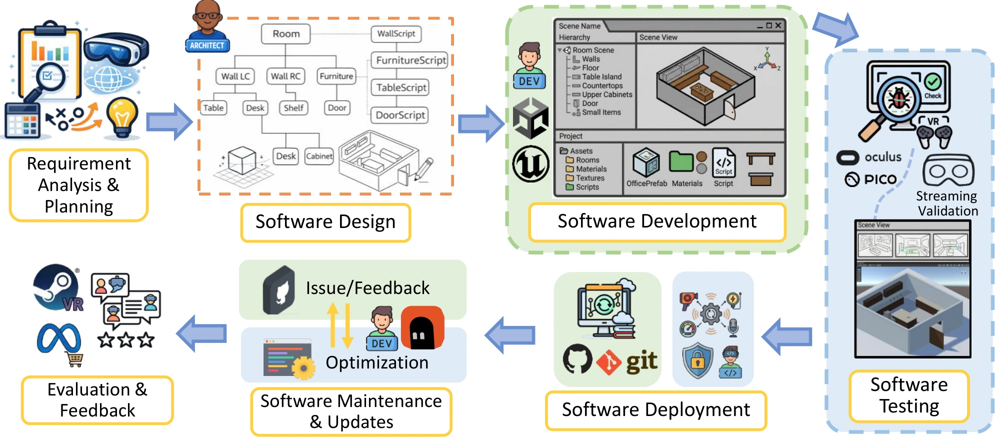
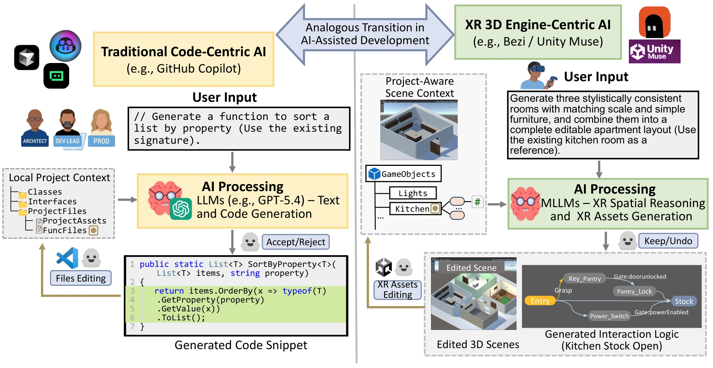

[English](README.md) · [中文](README.zh-CN.md)

# XR Software Engineering Survey

Software Engineering Practice in the Virtual Reality/Augmented Reality Software Life Cycle: A Systematic Survey

系统梳理 VR/AR 软件全生命周期的软件工程实践，汇集分类论文、研究洞察与开发资源。

[arXiv](https://arxiv.org/abs/2611.18567) · [项目网站](https://tsingpig.github.io/XR-Software-Engineering-Survey/zh/) · [论文库](https://tsingpig.github.io/XR-Software-Engineering-Survey/zh/papers/)

Hanyang Guo, Jingwen Wu, Zhengyang Zhu, Gengyang Xu, Hong-Ning Dai, Xiapu Luo, Zibin Zheng



**117 篇研究论文 · 7 个生命周期阶段 · 5 个研究专题**

## 专题阅读清单

### [空间交互重塑工程方法。](lists/zh/spatial.md)

六自由度、具身输入与舒适性，将界面设计、场景探索和质量保证连接起来。

- [VRExplorer: A Model-based Approach for Semi-Automated Testing of Virtual Reality Scenes](https://doi.org/10.1109/ASE63991.2025.00047)
- [Less Cybersickness, Please: Demystifying and Detecting Stereoscopic Visual Inconsistencies in Virtual Reality Apps](https://doi.org/10.1145/3660803)

### [AI 辅助深入引擎与项目上下文。](lists/zh/ai.md)

辅助范围延伸至场景、资产、交互逻辑和引擎设置，项目上下文成为 XR 开发的重要组成。



- [GaussianShopVR: Facilitating Immersive 3D Authoring Using Gaussian Splatting in VR](https://doi.org/10.1145/3746059.3747803)
- [ImaginateAR: AI-Assisted In-Situ Authoring in Augmented Reality](https://doi.org/10.1145/3746059.3747635)

### [沉浸式交互改变攻击面。](lists/zh/security.md)

空间界面与运动追踪，使软件安全与用户感知、行为和身份紧密相连。

- [VPVet: Vetting Privacy Policies of Virtual Reality Apps](https://doi.org/10.1145/3658644.3690321)
- [Erebus: Access Control for Augmented Reality Systems](https://www.usenix.org/conference/usenixsecurity23/presentation/kim-yoonsang)

### [维护跨越代码、资产与配置。](lists/zh/maintenance.md)

性能问题与代码异味的修复，常常需要协同修改脚本、三维资产与引擎配置。

- [Analyzing Performance Issues of Virtual Reality Applications](https://arxiv.org/abs/2211.02013)
- [XRFix: Exploring Performance Bug Repair of Extended Reality Applications with Large Language Models](https://doi.org/10.1145/3744916.3773120)

### [反馈连接软件质量与用户体验。](lists/zh/evaluation.md)

运行测量、体验研究与开发者反馈，为可扩展、以人为中心的质量保证提供研究方向。

- [Extended Reality Cybersickness Assessment via User Review Analysis](https://doi.org/10.1145/3728933)
- [CreepyCoCreator? Investigating AI Representation Modes for 3D Object Co-Creation in Virtual Reality](https://doi.org/10.1145/3706598.3713720)

## 分类论文列表

- [需求与规划](#requirements) · 14
- [软件设计](#design) · 22
- [软件开发](#development) · 19
- [软件测试](#testing) · 20
- [软件部署](#deployment) · 36
- [维护与更新](#maintenance) · 7
- [评估与反馈](#evaluation) · 8
- [相关综述](#related) · 8

<a id="requirements"></a>

## 需求与规划

将用户需求与空间约束转化为可实现的软件需求。

### 需求获取

| 年份 | 发表场所 | 论文标题 | 核心工作 | 链接 |
| --- | --- | --- | --- | --- |
| 2024 | ACM IMWUT | [EStatiG: Wearable Haptic Feedback with Multi-Phalanx Electrostatic Brake for Enhanced Object Perception in VR](https://doi.org/10.1145/3678567) | 通过多指节静电制动器提供可穿戴触觉反馈，增强虚拟物体感知。 | [Paper](https://doi.org/10.1145/3678567) |
| 2024 | Heritage Science | [Gamification of virtual museum curation: a case study of Chinese bronze wares](https://doi.org/10.1186/s40494-024-01464-2) | 结合青铜器扫描模型、沉浸式博物馆场景与游戏，支持文化知识学习。 | [Paper](https://doi.org/10.1186/s40494-024-01464-2) |
| 2024 | ACM IMWUT | [HapticPilot: Authoring In-situ Hand Posture-Adaptive Vibrotactile Feedback for Virtual Reality](https://doi.org/10.1145/3631453) | 支持为 VR 交互创作适应手部姿态的振动触觉反馈。 | [Paper](https://doi.org/10.1145/3631453) |
| 2023 | ISEC | [Requirements Elicitation for Virtual Reality Products - A Mapping Study](https://doi.org/10.1145/3578527.3578536) | 梳理 VR 产品需求获取的技术与实践。 | [Paper](https://doi.org/10.1145/3578527.3578536) |
| 2022 | ISMAR Adjunct | [VR4HcRE: Virtual Reality Platform for Human-centric Requirements Elicitation](https://doi.org/10.1109/ISMAR-Adjunct57072.2022.00168) | 提供面向人的 VR 需求获取平台。 | [Paper](https://doi.org/10.1109/ISMAR-Adjunct57072.2022.00168) |
| 2017 | AVR | [Virtual reality system for training in automotive mechanics](https://doi.org/10.1007/978-3-319-60922-5_14) | 围绕实际维修任务构建汽车机械技能 VR 训练系统。 | [Paper](https://doi.org/10.1007/978-3-319-60922-5_14) |

### 需求分析

| 年份 | 发表场所 | 论文标题 | 核心工作 | 链接 |
| --- | --- | --- | --- | --- |
| 2024 | ACM IMWUT | [Examining Psychological Conflict-Handling Strategies for Highly Automated Vehicles to Resolve Legal User-Vehicle Conflicts](https://doi.org/10.1145/3678511) | 通过 VR 驾驶模拟研究高度自动驾驶车辆的说服型冲突处理策略。 | [Paper](https://doi.org/10.1145/3678511) |
| 2024 | MODELS | [M2AR: A Web-based Modeling Environment for the Augmented Reality Workflow Modeling Language](https://doi.org/10.1145/3652620.3687779) | 提供用于描述 AR 应用工作流的 Web 建模环境。 | [Paper](https://doi.org/10.1145/3652620.3687779) |
| 2024 | ACM TOSEM | [RE Methods for Virtual Reality Software Product Development: A Mapping Study](https://doi.org/10.1145/3649595) | 梳理 VR 软件产品开发中采用的需求工程方法。 | [Paper](https://doi.org/10.1145/3649595) |
| 2022 | ASE | [A Role Based Model Template for Specifying Virtual Reality Software](https://doi.org/10.1145/3551349.3560514) | 提出基于角色的元模型，用于描述 VR 软件系统的核心要素。 | [Paper](https://doi.org/10.1145/3551349.3560514) |
| 2018 | ACM PACMHCI (CSCW) | [UMI3D: A Unity3D Toolbox to Support CSCW Systems Properties in Generic 3D User Interfaces](https://doi.org/10.1145/3274298) | 提供 Unity 工具箱，支持面向协同工作的通用三维界面。 | [Paper](https://doi.org/10.1145/3274298) |

### 需求规约

| 年份 | 发表场所 | 论文标题 | 核心工作 | 链接 |
| --- | --- | --- | --- | --- |
| 2025 | ICSE Companion | [VReqST: A Requirement Specification Tool for Virtual Reality Software Products](https://doi.org/10.1109/ICSE-Companion66252.2025.00012) | 提供面向 VR 软件产品的需求规约工具。 | [Paper](https://doi.org/10.1109/ICSE-Companion66252.2025.00012) |
| 2022 | ASE | [A Role Based Model Template for Specifying Virtual Reality Software](https://doi.org/10.1145/3551349.3560514) | 提出基于角色的元模型，用于描述 VR 软件系统的核心要素。 | [Paper](https://doi.org/10.1145/3551349.3560514) |

### 需求验证与管理

| 年份 | 发表场所 | 论文标题 | 核心工作 | 链接 |
| --- | --- | --- | --- | --- |
| 2021 | Advances in Engineering Software | [Distributed Microscopic Traffic Simulation with Human-in-the-Loop Enabled by Virtual Reality Technologies](https://doi.org/10.1016/j.advengsoft.2021.102985) | 将 VR 中的人员参与融入分布式微观交通仿真。 | [Paper](https://doi.org/10.1016/j.advengsoft.2021.102985) |
| 2019 | CHI | [360proto: Making Interactive Virtual Reality & Augmented Reality Prototypes from Paper](https://doi.org/10.1145/3290605.3300826) | 将纸面草图转化为可交互的 VR 与 AR 原型，支持快速体验验证。 | [Paper](https://doi.org/10.1145/3290605.3300826) |

<a id="design"></a>

## 软件设计

围绕三维空间、身体运动与舒适性设计交互体验。

### 草图设计

| 年份 | 发表场所 | 论文标题 | 核心工作 | 链接 |
| --- | --- | --- | --- | --- |
| 2021 | Mindtrek | [Immersive Video Sketching: Low-Fidelity Extended Reality Prototyping for Everyone](https://doi.org/10.1145/3464327.3464330) | 使用沉浸式视频草图创建易于制作的低保真 XR 体验原型。 | [Paper](https://doi.org/10.1145/3464327.3464330) |
| 2020 | CHI | [VRSketchIn: Exploring the Design Space of Pen and Tablet Interaction for 3D Sketching in Virtual Reality](https://doi.org/10.1145/3313831.3376628) | 探索在 VR 中使用数字笔与平板进行三维草图绘制的交互技术。 | [Paper](https://doi.org/10.1145/3313831.3376628) |
| 2019 | CHI EA | [What You Sketch Is What You Get: Quick and Easy Augmented Reality Prototyping with PintAR](https://doi.org/10.1145/3290607.3312847) | 支持设计者使用数字笔绘制草图，并与生成的 AR 原型交互。 | [Paper](https://doi.org/10.1145/3290607.3312847) |
| 2012 | Personal and Ubiquitous Computing | [Sketching up the World: In Situ Authoring for Mobile Augmented Reality](https://doi.org/10.1007/s00779-011-0430-0) | 支持用户通过手机在真实环境中绘制并创建移动 AR 内容。 | [Paper](https://doi.org/10.1007/s00779-011-0430-0) |
| 2010 | IEEE VR | [In-Place Sketching for Content Authoring in Augmented Reality Games](https://doi.org/10.1109/VR.2010.5444806) | 探索将原位草图作为创作 AR 游戏内容的视觉语言。 | [Paper](https://doi.org/10.1109/VR.2010.5444806) |

### 三维交互

| 年份 | 发表场所 | 论文标题 | 核心工作 | 链接 |
| --- | --- | --- | --- | --- |
| 2025 | CHI | [Exploring the Design Space of Privacy-Driven Adaptation Techniques for Future Augmented Reality Interfaces](https://doi.org/10.1145/3706598.3713320) | 探索响应 AR 隐私需求的界面自适应技术。 | [Paper](https://doi.org/10.1145/3706598.3713320) |
| 2022 | CHI | [Elements of XR Prototyping: Characterizing the Role and Use of Prototypes in Augmented and Virtual Reality Design](https://doi.org/10.1145/3491102.3517714) | 分析原型在 AR 与 VR 项目设计中的作用与使用方式。 | [Paper](https://doi.org/10.1145/3491102.3517714) |
| 2021 | CHI | [Current practices, challenges, and design implications for collaborative AR/VR application development](https://doi.org/10.1145/3411764.3445335) | 访谈 AR/VR 从业者，识别开发角色、协作挑战与工具需求。 | [Paper](https://doi.org/10.1145/3411764.3445335) |
| 2021 | VRST | [Research and Practice Recommendations for Mixed Reality Design – Different Perspectives from the Community](https://doi.org/10.1145/3489849.3489876) | 汇集社区观点，形成混合现实设计与研究建议。 | [Paper](https://doi.org/10.1145/3489849.3489876) |
| 2020 | HORA | [Modern Virtual Reality Headsets](https://doi.org/10.1109/HORA49412.2020.9152604) | 回顾现代 VR 头显及其沉浸式交互特性。 | [Paper](https://doi.org/10.1109/HORA49412.2020.9152604) |
| 1995 | CHI | [Virtual reality on a WIM: interactive worlds in miniature](https://doi.org/10.1145/223904.223938) | 提出微缩世界交互，通过小比例表示查看和操纵虚拟环境。 | [Paper](https://doi.org/10.1145/223904.223938) |

### 故事板

| 年份 | 发表场所 | 论文标题 | 核心工作 | 链接 |
| --- | --- | --- | --- | --- |
| 2024 | INTETAIN | [A Novel Approach to 3D Storyboarding](https://doi.org/10.1007/978-3-031-55722-4_13) | 根据三维场景、角色动作与相机设置生成故事板及场景描述。 | [Paper](https://doi.org/10.1007/978-3-031-55722-4_13) |
| 2022 | ACM PACMHCI (EICS) | [Software Engineering for Augmented Reality - A Research Agenda](https://doi.org/10.1145/3532205) | 回顾 AR 软件工程，提出面向方法与工具的研究议程。 | [Paper](https://doi.org/10.1145/3532205) |

### 用户体验、舒适性与触觉

| 年份 | 发表场所 | 论文标题 | 核心工作 | 链接 |
| --- | --- | --- | --- | --- |
| 2022 | Frontiers in Virtual Reality | [Effects of simulated augmented reality cueing in a virtual navigation task](https://doi.org/10.3389/frvir.2022.971310) | 在 VR 中评估 AR 式导航提示对空间学习、认知负荷与情境感知的影响。 | [Paper](https://doi.org/10.3389/frvir.2022.971310) |
| 2020 | CVPR | [3D Photography Using Context-Aware Layered Depth Inpainting](https://openaccess.thecvf.com/content_CVPR_2020/html/Shih_3D_Photography_Using_Context-Aware_Layered_Depth_Inpainting_CVPR_2020_paper.html) | 通过感知上下文的颜色与深度补全，将 RGB-D 图像转换为分层三维照片。 | [Paper](https://openaccess.thecvf.com/content_CVPR_2020/html/Shih_3D_Photography_Using_Context-Aware_Layered_Depth_Inpainting_CVPR_2020_paper.html) · [arXiv](https://arxiv.org/abs/2004.04727) · [Project](https://shihmengli.github.io/3D-Photo-Inpainting/) |
| 2020 | Virtual Reality | [Effects of steering locomotion and teleporting on cybersickness and presence in HMD-based virtual reality](https://doi.org/10.1007/s10055-019-00407-8) | 通过晕动症与临场感测量比较转向移动和传送移动。 | [Paper](https://doi.org/10.1007/s10055-019-00407-8) |
| 2020 | CHI | [WalkingVibe: Reducing Virtual Reality Sickness and Improving Realism while Walking in VR using Unobtrusive Head-mounted Vibrotactile Feedback](https://doi.org/10.1145/3313831.3376847) | 研究通过头戴式振动触觉反馈缓解 VR 晕动症并改善行走真实感。 | [Paper](https://doi.org/10.1145/3313831.3376847) |
| 2019 | International Journal of Emerging Technologies in Learning | [Augmented Reality and Virtual Reality in Education. Myth or Reality?](https://doi.org/10.3991/ijet.v14i03.9289) | 讨论 AR 与 VR 在教育中的应用及沉浸式学习机会。 | [Paper](https://doi.org/10.3991/ijet.v14i03.9289) |
| 2017 | Experimental Brain Research | [The virtual reality head-mounted display Oculus Rift induces motion sickness and is sexist in its effects](https://doi.org/10.1007/s00221-016-4846-7) | 测量 Oculus Rift 游戏过程中的晕动症与姿态反应。 | [Paper](https://doi.org/10.1007/s00221-016-4846-7) |
| 2016 | Virtual Reality | [Review on cybersickness in applications and visual displays](https://doi.org/10.1007/s10055-016-0285-9) | 梳理沉浸式应用与视觉显示中的晕动症因素、测量方法和缓解策略。 | [Paper](https://doi.org/10.1007/s10055-016-0285-9) |
| 2002 | Applied Ergonomics | [Health and safety implications of virtual reality: a review of empirical evidence](https://doi.org/10.1016/S0003-6870(02)00020-0) | 回顾 VR 使用对健康与安全影响的实证证据。 | [Paper](https://doi.org/10.1016/S0003-6870(02)00020-0) |
| 2000 | ACM SIGCHI Bulletin | [A discussion of cybersickness in virtual environments](https://doi.org/10.1145/333329.333344) | 讨论虚拟环境中晕动症的原因、症状与缓解方法。 | [Paper](https://doi.org/10.1145/333329.333344) |

<a id="development"></a>

## 软件开发

在沉浸式开发流程中构建场景、资产与交互逻辑。

### 框架与沉浸式开发环境

| 年份 | 发表场所 | 论文标题 | 核心工作 | 链接 |
| --- | --- | --- | --- | --- |
| 2025 | IDE @ ICSE | [Code Refactoring in Virtual Reality](https://doi.org/10.1109/IDE66625.2025.00006) | 通过空间程序可视化与控制器交互，探索在 VR 中执行代码重构。 | [Paper](https://doi.org/10.1109/IDE66625.2025.00006) |
| 2025 | UIST | [GaussianShopVR: Facilitating Immersive 3D Authoring Using Gaussian Splatting in VR](https://doi.org/10.1145/3746059.3747803) | 支持在 VR 中沉浸式编辑与创作三维高斯泼溅内容。 | [Paper](https://doi.org/10.1145/3746059.3747803) |
| 2025 | UIST | [ImaginateAR: AI-Assisted In-Situ Authoring in Augmented Reality](https://doi.org/10.1145/3746059.3747635) | 结合场景理解、三维资产生成与语音交互，支持原位 AR 创作。 | [Paper](https://doi.org/10.1145/3746059.3747635) · [arXiv](https://arxiv.org/abs/2504.21360) |
| 2025 | UIST Adjunct | [RealityCrafter: User-guided Editable 3D Scene Generation from a Single Image in Mixed Reality](https://doi.org/10.1145/3746058.3758405) | 在用户引导下，从单张图像生成可编辑的混合现实场景。 | [Paper](https://doi.org/10.1145/3746058.3758405) |
| 2025 | CHI | [RemapVR: An Immersive Authoring Tool for Rapid Prototyping of Remapped Interaction in VR](https://doi.org/10.1145/3706598.3714201) | 提供沉浸式创作工具，用于原型设计与检查 VR 重映射交互。 | [Paper](https://doi.org/10.1145/3706598.3714201) |
| 2022 | ICECAA | [Analysis of Virtual Reality and Augmented Reality SDK’s and Game Engines: A Comparison](https://doi.org/10.1109/ICECAA55415.2022.9936111) | 比较用于 VR 与 AR 应用开发的 SDK 和游戏引擎。 | [Paper](https://doi.org/10.1109/ICECAA55415.2022.9936111) |
| 2022 | USENIX Security | [OVRseen: Auditing Network Traffic and Privacy Policies in Oculus VR](https://www.usenix.org/conference/usenixsecurity22/presentation/trimananda) | 对照隐私政策审计 Oculus VR 网络流量，研究数据收集与披露。 | [Paper](https://www.usenix.org/conference/usenixsecurity22/presentation/trimananda) |
| 2021 | ICPC | [Automatic Extraction of Code Dependency in Virtual Reality Software](https://doi.org/10.1109/ICPC52881.2021.00043) | 提取 VR 软件中的代码依赖，支持程序理解。 | [Paper](https://doi.org/10.1109/ICPC52881.2021.00043) |
| 2020 | ISCV | [ARKit and ARCore in serve to augmented reality](https://doi.org/10.1109/ISCV49265.2020.9204243) | 分析 ARKit 与 ARCore 在增强现实应用开发中的作用。 | [Paper](https://doi.org/10.1109/ISCV49265.2020.9204243) |
| 2018 | QRS | [The State of Practice on Virtual Reality (VR) Applications: An Exploratory Study on Github and Stack Overflow](https://doi.org/10.1109/QRS.2018.00048) | 通过 GitHub 项目与 Stack Overflow 讨论研究 VR 应用开发实践。 | [Paper](https://doi.org/10.1109/QRS.2018.00048) |

### 交互实现

| 年份 | 发表场所 | 论文标题 | 核心工作 | 链接 |
| --- | --- | --- | --- | --- |
| 2025 | UIST | [ImaginateAR: AI-Assisted In-Situ Authoring in Augmented Reality](https://doi.org/10.1145/3746059.3747635) | 结合场景理解、三维资产生成与语音交互，支持原位 AR 创作。 | [Paper](https://doi.org/10.1145/3746059.3747635) · [arXiv](https://arxiv.org/abs/2504.21360) |
| 2025 | UIST Adjunct | [RealityCrafter: User-guided Editable 3D Scene Generation from a Single Image in Mixed Reality](https://doi.org/10.1145/3746058.3758405) | 在用户引导下，从单张图像生成可编辑的混合现实场景。 | [Paper](https://doi.org/10.1145/3746058.3758405) |
| 2025 | CHI | [RemapVR: An Immersive Authoring Tool for Rapid Prototyping of Remapped Interaction in VR](https://doi.org/10.1145/3706598.3714201) | 提供沉浸式创作工具，用于原型设计与检查 VR 重映射交互。 | [Paper](https://doi.org/10.1145/3706598.3714201) |
| 2022 | ACM TOPS | [Hidden in Plain Sight: Exploring Privacy Risks of Mobile Augmented Reality Applications](https://doi.org/10.1145/3524020) | 分析移动 AR 的隐藏操作，并设计保护用户隐私的交互机制。 | [Paper](https://doi.org/10.1145/3524020) |
| 2022 | IEEE VR Workshops | [Reality Check of Metaverse: A First Look at Commercial Social Virtual Reality Platforms](https://doi.org/10.1109/VRW55335.2022.00040) | 测量商用社交 VR 的网络协议、多媒体传输与带宽需求。 | [Paper](https://doi.org/10.1109/VRW55335.2022.00040) |
| 2022 | IEEE Network | [Will Metaverse Be NextG Internet? Vision, Hype, and Reality](https://doi.org/10.1109/MNET.117.2200055) | 比较商用元宇宙平台，将网络性能与部署需求及基础设施研究连接起来。 | [Paper](https://doi.org/10.1109/MNET.117.2200055) |

### 性能、服务质量与体验质量

| 年份 | 发表场所 | 论文标题 | 核心工作 | 链接 |
| --- | --- | --- | --- | --- |
| 2024 | Multimedia Tools and Applications | [Content format and quality of experience in virtual reality](https://doi.org/10.1007/s11042-022-12176-9) | 考察 VR 内容格式对沉浸式观看体验质量的影响。 | [Paper](https://doi.org/10.1007/s11042-022-12176-9) |
| 2024 | Applied Sciences | [Impact of Latency on QoE, Performance, and Collaboration in Interactive Multi-User Virtual Reality](https://www.mdpi.com/2076-3417/14/6/2290) | 研究网络时延对多用户 VR 体验、任务表现与协作的影响。 | [Paper](https://www.mdpi.com/2076-3417/14/6/2290) · [DOI](https://doi.org/10.3390/app14062290) |
| 2022 | arXiv | [Analyzing Performance Issues of Virtual Reality Applications](https://arxiv.org/abs/2211.02013) | 提炼虚幻引擎性能缺陷模式，并检测配置文件与 C++ 代码中的性能缺陷。 | [Paper](https://arxiv.org/abs/2211.02013) |
| 2021 | ICSE | [How Developers Optimize Virtual Reality Applications: A Study of Optimization Commits in Open Source Unity Projects](https://doi.org/10.1109/ICSE43902.2021.00052) | 分类真实 Unity VR 项目中的图形简化、渲染与内存优化。 | [Paper](https://doi.org/10.1109/ICSE43902.2021.00052) |
| 2020 | ProQuest Dissertations and Theses | [An Empirical Analysis of Unity Performance Bugs](https://www.proquest.com/dissertations-theses/empirical-analysis-unity-performance-bugs/docview/2447297064/se-2) | 分析 Unity 性能修复，揭示源代码修改与预制体及资产修改之间的联系。 | [Paper](https://www.proquest.com/dissertations-theses/empirical-analysis-unity-performance-bugs/docview/2447297064/se-2) |
| 2020 | MSR | [Detecting Video Game-Specific Bad Smells in Unity Projects](https://doi.org/10.1145/3379597.3387454) | 提出 UnityLinter，检测游戏特有的性能、可维护性与行为异味。 | [Paper](https://doi.org/10.1145/3379597.3387454) |

<a id="testing"></a>

## 软件测试

探索场景，检验功能行为、视觉质量与可用性。

### 缺陷与测试异味

| 年份 | 发表场所 | 论文标题 | 核心工作 | 链接 |
| --- | --- | --- | --- | --- |
| 2025 | ASE | [VRTestSniffer: Test Smell Detector for Virtual Reality (VR) Software Projects](https://doi.org/10.1109/ASE63991.2025.00163) | 通过语法、控制流与数据流分析，检测 Unity 测试中的 VR 特有测试异味。 | [Paper](https://doi.org/10.1109/ASE63991.2025.00163) · [Code](https://github.com/smilevo/VRTestSniffer) |
| 2021 | ICSE | [How Developers Optimize Virtual Reality Applications: A Study of Optimization Commits in Open Source Unity Projects](https://doi.org/10.1109/ICSE43902.2021.00052) | 分类真实 Unity VR 项目中的图形简化、渲染与内存优化。 | [Paper](https://doi.org/10.1109/ICSE43902.2021.00052) |
| 2020 | ISSRE | [An Exploratory Study of Bugs in Extended Reality Applications on the Web](https://doi.org/10.1109/ISSRE5003.2020.00025) | 构建 WebXR 缺陷分类，涵盖设备不兼容、交互处理与应用故障。 | [Paper](https://doi.org/10.1109/ISSRE5003.2020.00025) |

### 功能测试

| 年份 | 发表场所 | 论文标题 | 核心工作 | 链接 |
| --- | --- | --- | --- | --- |
| 2025 | ASE Workshops | [A Test Automation Framework for User Interaction in Extended Reality Applications](https://doi.org/10.1109/ASEW67777.2025.00066) | 提出 INTENXION，通过 API 模拟组合式 XR 交互并断言预期结果。 | [Paper](https://doi.org/10.1109/ASEW67777.2025.00066) |
| 2023 | ISSTA | [Virtual Reality (VR) Automated Testing in the Wild: A Case Study on Unity-Based VR Applications](https://doi.org/10.1145/3597926.3598134) | 分析开源 Unity VR 应用的自动化测试实践与测试类型。 | [Paper](https://doi.org/10.1145/3597926.3598134) |
| 2018 | Software Testing, Verification and Reliability | [An automated functional testing approach for virtual reality applications](https://doi.org/10.1002/stvr.1690) | 从 VR 行为的半形式化规约生成测试需求与功能测试数据。 | [Paper](https://doi.org/10.1002/stvr.1690) |

### 界面与视觉测试

| 年份 | 发表场所 | 论文标题 | 核心工作 | 链接 |
| --- | --- | --- | --- | --- |
| 2025 | ASE | [VRExplorer: A Model-based Approach for Semi-Automated Testing of Virtual Reality Scenes](https://doi.org/10.1109/ASE63991.2025.00047) | 建模实体、动作与任务，引导 VR 测试中的导航与多类型交互。 | [Paper](https://doi.org/10.1109/ASE63991.2025.00047) · [arXiv](https://arxiv.org/abs/2607.10174) · [Code](https://github.com/TsingPig/VRExplorer_Release) |
| 2024 | FSE | [Less Cybersickness, Please: Demystifying and Detecting Stereoscopic Visual Inconsistencies in Virtual Reality Apps](https://doi.org/10.1145/3660803) | 提出 StereoID，基于左右眼渲染图像检测立体视觉不一致问题。 | [Paper](https://doi.org/10.1145/3660803) · [arXiv](https://arxiv.org/abs/2406.09313) |
| 2023 | ISSTA | [Virtual Reality (VR) Automated Testing in the Wild: A Case Study on Unity-Based VR Applications](https://doi.org/10.1145/3597926.3598134) | 分析开源 Unity VR 应用的自动化测试实践与测试类型。 | [Paper](https://doi.org/10.1145/3597926.3598134) |
| 2023 | ASE | [VRGuide: Efficient Testing of Virtual Reality Scenes via Dynamic Cut Coverage](https://doi.org/10.1109/ASE56229.2023.00197) | 利用动态切面覆盖引导相机移动，提升 VR 场景探索效率。 | [Paper](https://doi.org/10.1109/ASE56229.2023.00197) |
| 2022 | ICSE Companion | [VRTest: An extensible framework for automatic testing of virtual reality scenes](https://doi.org/10.1109/ICSE-Companion55297.2022.9793753) | 通过相机控制与随机或贪心交互策略，自动探索 VR 场景。 | [Paper](https://doi.org/10.1109/ICSE-Companion55297.2022.9793753) |

### 可用性测试

| 年份 | 发表场所 | 论文标题 | 核心工作 | 链接 |
| --- | --- | --- | --- | --- |
| 2024 | FSE | [Less Cybersickness, Please: Demystifying and Detecting Stereoscopic Visual Inconsistencies in Virtual Reality Apps](https://doi.org/10.1145/3660803) | 提出 StereoID，基于左右眼渲染图像检测立体视觉不一致问题。 | [Paper](https://doi.org/10.1145/3660803) · [arXiv](https://arxiv.org/abs/2406.09313) |
| 2024 | ISSTA | [Towards Automatic Oracle Prediction for AR Testing: Assessing Virtual Object Placement Quality under Real-World Scenes](https://doi.org/10.1145/3650212.3680315) | 结合场景元数据与图像学习，检测 AR 物体放置不准确的问题。 | [Paper](https://doi.org/10.1145/3650212.3680315) |
| 2022 | ASE | [PredART: Towards automatic oracle prediction of object placements in augmented reality testing](https://doi.org/10.1145/3551349.3561160) | 预测人类对虚拟物体放置质量的判断，构建 AR 可用性测试预言。 | [Paper](https://doi.org/10.1145/3551349.3561160) |
| 2020 | ICST | [Agent-based testing of extended reality systems](https://doi.org/10.1109/ICST46399.2020.00051) | 结合自主认知测试代理与情感建模，评估 XR 行为和用户体验。 | [Paper](https://doi.org/10.1109/ICST46399.2020.00051) |
| 2020 | IEEE VR | [ARCHIE: A user-focused framework for testing augmented reality applications in the wild](https://doi.org/10.1109/VR46266.2020.00013) | 将用户反馈与运行遥测关联，定位 AR 性能与可用性问题。 | [Paper](https://doi.org/10.1109/VR46266.2020.00013) |
| 2018 | IEEE CIG | [A virtual agent toolkit for serious games developers](https://doi.org/10.1109/CIG.2018.8490399) | 提供 FAtiMA 工具包，支持具有情感与社会行为的虚拟代理开发。 | [Paper](https://doi.org/10.1109/CIG.2018.8490399) |

### 安全测试

| 年份 | 发表场所 | 论文标题 | 核心工作 | 链接 |
| --- | --- | --- | --- | --- |
| 2023 | USENIX Security | [A peek into the metaverse: detecting 3D model clones in mobile games](https://www.usenix.org/conference/usenixsecurity23/presentation/zuo) | 通过规范化资产比较，检测 Unity 移动游戏中的静态与动画三维模型克隆。 | [Paper](https://www.usenix.org/conference/usenixsecurity23/presentation/zuo) |

### 测试工具

| 年份 | 发表场所 | 论文标题 | 核心工作 | 链接 |
| --- | --- | --- | --- | --- |
| 2026 | Automated Software Engineering | [Harnessing large language models for virtual reality exploration testing: a case study](https://doi.org/10.1007/s10515-025-00535-3) | 评估大模型在黑盒 VR 探索测试中的实体检测、特征描述与空间推理能力。 | [Paper](https://doi.org/10.1007/s10515-025-00535-3) · [Code](https://github.com/qzydustin/LLM4VR) |
| 2024 | arXiv | [Grounded GUI Understanding for Vision Based Spatial Intelligent Agent: Exemplified by Virtual Reality Apps](https://arxiv.org/abs/2409.10811) | 提出 Orienter，利用多模态模型识别 VR 场景中与上下文相关的可交互界面元素。 | [Paper](https://arxiv.org/abs/2409.10811) |
| 2024 | ASE Workshops | [Utilizing Generative AI for VR Exploration Testing: A Case Study](https://doi.org/10.1145/3691621.3694955) | 研究生成式 AI 从 VR 视野图像识别测试实体与空间特征的能力。 | [Paper](https://doi.org/10.1145/3691621.3694955) |
| 2022 | ASE | [DyTRec: A Dynamic Testing Recommendation tool for Unity-based Virtual Reality Software](https://doi.org/10.1145/3551349.3560510) | 分析 Unity API 及其在 VR 源代码中的使用，推荐动态测试类型。 | [Paper](https://doi.org/10.1145/3551349.3560510) |

<a id="deployment"></a>

## 软件部署

分发 XR 软件，保护沉浸式界面与行为数据。

### 分发平台

| 年份 | 发表场所 | 论文标题 | 核心工作 | 链接 |
| --- | --- | --- | --- | --- |
| 2026 | IEEE Transactions on Networking | [Vetting Privacy Policies in Virtual Reality Platforms With Longitudinal Analysis](https://doi.org/10.1109/TON.2025.3618730) | 纵向追踪 VR 平台隐私政策，分析政策质量及其变化。 | [Paper](https://doi.org/10.1109/TON.2025.3618730) |
| 2024 | IEEE Security & Privacy | [Understanding Privacy in Virtual Reality Classrooms: A Contextual Integrity Perspective](https://doi.org/10.1109/MSEC.2023.3336802) | 通过情境完整性分析 VR 课堂的信息流及情境相关的隐私预期。 | [Paper](https://doi.org/10.1109/MSEC.2023.3336802) |
| 2024 | CCS | [VPVet: Vetting Privacy Policies of Virtual Reality Apps](https://doi.org/10.1145/3658644.3690321) | 提出 VPVet，分析 VR 隐私政策的数据收集粒度、最小化与陈述一致性。 | [Paper](https://doi.org/10.1145/3658644.3690321) · [arXiv](https://arxiv.org/abs/2409.00740) · [Code](https://github.com/kalamoo/PPAudit) |
| 2022 | ASE | [A Study of User Privacy in Android Mobile AR Apps](https://doi.org/10.1145/3551349.3560512) | 考察 Android 移动 AR 应用中的用户隐私实践与数据处理。 | [Paper](https://doi.org/10.1145/3551349.3560512) |
| 2022 | IEEE Transactions on Games | [Beyond Genre: Classifying Virtual Reality Experiences](https://doi.org/10.1109/TG.2021.3119521) | 超越传统游戏类型划分 VR 体验，支持平台中的内容发现与比较。 | [Paper](https://doi.org/10.1109/TG.2021.3119521) |
| 2022 | USENIX Security | [OVRseen: Auditing Network Traffic and Privacy Policies in Oculus VR](https://www.usenix.org/conference/usenixsecurity22/presentation/trimananda) | 对照隐私政策审计 Oculus VR 网络流量，研究数据收集与披露。 | [Paper](https://www.usenix.org/conference/usenixsecurity22/presentation/trimananda) |

### 版本控制与更新

| 年份 | 发表场所 | 论文标题 | 核心工作 | 链接 |
| --- | --- | --- | --- | --- |
| 2026 | ICSE | [XRFix: Exploring Performance Bug Repair of Extended Reality Applications with Large Language Models](https://doi.org/10.1145/3744916.3773120) | 提出 XRFix，利用大模型生成并验证 XR 应用的性能缺陷修复。 | [Paper](https://doi.org/10.1145/3744916.3773120) · [arXiv](https://arxiv.org/abs/2608.21718) · [Code](https://github.com/wwwjwww/XRFix) |
| 2025 | CCS | [Virtual Reality, Real Problems: A Longitudinal Security Analysis of VR Firmware](https://doi.org/10.1145/3719027.3765102) | 追踪 VR 固件演进，识别安全弱点与易受攻击组件的持续存在。 | [Paper](https://doi.org/10.1145/3719027.3765102) |

### 沉浸式界面安全

| 年份 | 发表场所 | 论文标题 | 核心工作 | 链接 |
| --- | --- | --- | --- | --- |
| 2025 | CCS | [PipID: Light-Pupillary Response Based User Authentication for Virtual Reality](https://doi.org/10.1145/3719027.3744850) | 利用光诱发瞳孔响应，在 VR 头显中实现用户身份认证。 | [Paper](https://doi.org/10.1145/3719027.3744850) |
| 2025 | EASE | [SecCityVR: Visualization and Collaborative Exploration of Software Vulnerabilities in Virtual Reality](https://doi.org/10.1145/3756681.3756939) | 通过协作式 VR 城市可视化，探索软件漏洞及其关联。 | [Paper](https://doi.org/10.1145/3756681.3756939) |
| 2025 | USENIX Security | [Shadowed Realities: An Investigation of UI Attacks in WebXR](https://www.usenix.org/conference/usenixsecurity25/presentation/mukherjee) | 分析 WebXR 界面攻击，并测量暗黑设计对沉浸式用户行为的影响。 | [Paper](https://www.usenix.org/conference/usenixsecurity25/presentation/mukherjee) |
| 2025 | USENIX Security | [SoK: Come Together – Unifying Security, Information Theory, and Cognition for a Mixed Reality Deception Attack Ontology & Analysis Framework](https://www.usenix.org/conference/usenixsecurity25/presentation/teymourian) | 结合安全、信息论与认知，建立混合现实欺骗攻击的本体与分析框架。 | [Paper](https://www.usenix.org/conference/usenixsecurity25/presentation/teymourian) |
| 2024 | arXiv | [Inception Attacks: Immersive Hijacking in Virtual Reality Systems](https://arxiv.org/abs/2403.05721) | 通过伪装成 VR 系统界面的应用困住用户，展示沉浸式劫持攻击。 | [Paper](https://arxiv.org/abs/2403.05721) |
| 2024 | USENIX Security | [That doesn’t go there: attacks on shared state in Multi-User augmented reality applications](https://www.usenix.org/conference/usenixsecurity24/presentation/slocum) | 展示共享状态被操纵后，多用户 AR 交互与虚拟内容面临的安全问题。 | [Paper](https://www.usenix.org/conference/usenixsecurity24/presentation/slocum) |
| 2024 | CCS | [The Big Brother’s New Playground: Unmasking the Illusion of Privacy in Web Metaverses from a Malicious User’s Perspective](https://doi.org/10.1145/3658644.3690249) | 利用浏览器端元宇宙对象，研究恶意用户实施监视、追踪与隐私泄露的方式。 | [Paper](https://doi.org/10.1145/3658644.3690249) |
| 2024 | USENIX Security | [When the User Is Inside the User Interface: An Empirical Study of UI Security Properties in Augmented Reality](https://www.usenix.org/conference/usenixsecurity24/presentation/cheng-kaiming) | 通过平台测量与概念验证攻击，研究 AR 用户界面的安全属性。 | [Paper](https://www.usenix.org/conference/usenixsecurity24/presentation/cheng-kaiming) |
| 2023 | USENIX Security | [Erebus: Access Control for Augmented Reality Systems](https://www.usenix.org/conference/usenixsecurity23/presentation/kim-yoonsang) | 提出 Erebus，实现 AR 感知数据的细粒度、上下文感知访问控制。 | [Paper](https://www.usenix.org/conference/usenixsecurity23/presentation/kim-yoonsang) · [Code](https://github.com/Ethos-lab/erebus-AR_access_control) |
| 2023 | PoPETs | [Exploring the Privacy Risks of Adversarial VR Game Design](https://doi.org/10.56553/popets-2023-0108) | 利用对抗式 VR 游戏设计，研究游戏行为与运动暴露的敏感信息。 | [Paper](https://doi.org/10.56553/popets-2023-0108) |
| 2023 | USENIX Security | [It’s all in your head(set): side-channel attacks on AR/VR systems](https://www.usenix.org/conference/usenixsecurity23/presentation/zhang-yicheng) | 展示恶意软件侧信道对 AR/VR 手势、语音指令与虚拟键盘输入的推断。 | [Paper](https://www.usenix.org/conference/usenixsecurity23/presentation/zhang-yicheng) |
| 2022 | ACM TOPS | [Hidden in Plain Sight: Exploring Privacy Risks of Mobile Augmented Reality Applications](https://doi.org/10.1145/3524020) | 分析移动 AR 的隐藏操作，并设计保护用户隐私的交互机制。 | [Paper](https://doi.org/10.1145/3524020) |
| 2022 | IEEE TDSC | [Modeling and Defense of Social Virtual Reality Attacks Inducing Cybersickness](https://doi.org/10.1109/TDSC.2021.3121216) | 通过攻击故障树建模社交 VR 中诱发晕动症的攻击，并评估防御机制。 | [Paper](https://doi.org/10.1109/TDSC.2021.3121216) |
| 2022 | USENIX Security | [Playing Without Paying: Detecting Vulnerable Payment Verification in Native Binaries of Unity Mobile Games](https://www.usenix.org/conference/usenixsecurity22/presentation/zuo) | 分析 Unity 游戏原生二进制，检测存在漏洞的应用内支付验证。 | [Paper](https://www.usenix.org/conference/usenixsecurity22/presentation/zuo) |
| 2021 | USENIX Security | [AdCube: WebVR Ad Fraud and Practical Confinement of Third-Party Ads](https://www.usenix.org/conference/usenixsecurity21/presentation/lee-hyunjoo) | 揭示 WebVR 广告欺诈，并设计第三方沉浸式广告隔离机制。 | [Paper](https://www.usenix.org/conference/usenixsecurity21/presentation/lee-hyunjoo) |
| 2019 | USENIX Security | [Secure Multi-User Content Sharing for Augmented Reality Applications](https://www.usenix.org/conference/usenixsecurity19/presentation/ruth) | 基于物理与虚拟上下文定义权限，实现多用户 AR 内容的安全共享。 | [Paper](https://www.usenix.org/conference/usenixsecurity19/presentation/ruth) |

### 隐私与侧信道

| 年份 | 发表场所 | 论文标题 | 核心工作 | 链接 |
| --- | --- | --- | --- | --- |
| 2026 | IEEE Transactions on Networking | [Vetting Privacy Policies in Virtual Reality Platforms With Longitudinal Analysis](https://doi.org/10.1109/TON.2025.3618730) | 纵向追踪 VR 平台隐私政策，分析政策质量及其变化。 | [Paper](https://doi.org/10.1109/TON.2025.3618730) |
| 2025 | CCS | [PipID: Light-Pupillary Response Based User Authentication for Virtual Reality](https://doi.org/10.1145/3719027.3744850) | 利用光诱发瞳孔响应，在 VR 头显中实现用户身份认证。 | [Paper](https://doi.org/10.1145/3719027.3744850) |
| 2024 | CCS | [The Big Brother’s New Playground: Unmasking the Illusion of Privacy in Web Metaverses from a Malicious User’s Perspective](https://doi.org/10.1145/3658644.3690249) | 利用浏览器端元宇宙对象，研究恶意用户实施监视、追踪与隐私泄露的方式。 | [Paper](https://doi.org/10.1145/3658644.3690249) |
| 2024 | CCS | [VPVet: Vetting Privacy Policies of Virtual Reality Apps](https://doi.org/10.1145/3658644.3690321) | 提出 VPVet，分析 VR 隐私政策的数据收集粒度、最小化与陈述一致性。 | [Paper](https://doi.org/10.1145/3658644.3690321) · [arXiv](https://arxiv.org/abs/2409.00740) · [Code](https://github.com/kalamoo/PPAudit) |
| 2023 | USENIX Security | [Erebus: Access Control for Augmented Reality Systems](https://www.usenix.org/conference/usenixsecurity23/presentation/kim-yoonsang) | 提出 Erebus，实现 AR 感知数据的细粒度、上下文感知访问控制。 | [Paper](https://www.usenix.org/conference/usenixsecurity23/presentation/kim-yoonsang) · [Code](https://github.com/Ethos-lab/erebus-AR_access_control) |
| 2023 | PoPETs | [Exploring the Privacy Risks of Adversarial VR Game Design](https://doi.org/10.56553/popets-2023-0108) | 利用对抗式 VR 游戏设计，研究游戏行为与运动暴露的敏感信息。 | [Paper](https://doi.org/10.56553/popets-2023-0108) |
| 2023 | USENIX Security | [It’s all in your head(set): side-channel attacks on AR/VR systems](https://www.usenix.org/conference/usenixsecurity23/presentation/zhang-yicheng) | 展示恶意软件侧信道对 AR/VR 手势、语音指令与虚拟键盘输入的推断。 | [Paper](https://www.usenix.org/conference/usenixsecurity23/presentation/zhang-yicheng) |
| 2022 | IEEE VR | [A Keylogging Inference Attack on Air-Tapping Keyboards in Virtual Environments](https://doi.org/10.1109/VR51125.2022.00098) | 基于虚拟环境中可观察的手部运动模式，重建空中敲击键盘输入。 | [Paper](https://doi.org/10.1109/VR51125.2022.00098) |
| 2022 | ASE | [A Study of User Privacy in Android Mobile AR Apps](https://doi.org/10.1145/3551349.3560512) | 考察 Android 移动 AR 应用中的用户隐私实践与数据处理。 | [Paper](https://doi.org/10.1145/3551349.3560512) |
| 2022 | IEEE VR | [HoloLogger: Keystroke Inference on Mixed Reality Head Mounted Displays](https://doi.org/10.1109/VR51125.2022.00064) | 提出 HoloLogger，推断混合现实头戴显示器上的虚拟键盘输入。 | [Paper](https://doi.org/10.1109/VR51125.2022.00064) |
| 2022 | USENIX Security | [OVRseen: Auditing Network Traffic and Privacy Policies in Oculus VR](https://www.usenix.org/conference/usenixsecurity22/presentation/trimananda) | 对照隐私政策审计 Oculus VR 网络流量，研究数据收集与披露。 | [Paper](https://www.usenix.org/conference/usenixsecurity22/presentation/trimananda) |
| 2021 | CCS Poster | [POSTER: ReAvatar: Virtual Reality De-anonymization Attack Through Correlating Movement Signatures](https://doi.org/10.1145/3460120.3485345) | 关联不同 VR 会话中的运动特征，研究用户去匿名化。 | [Paper](https://doi.org/10.1145/3460120.3485345) |
| 2021 | IEEE VR | [VR-Spy: A Side-Channel Attack on Virtual Key-Logging in VR Headsets](https://doi.org/10.1109/VR50410.2021.00081) | 展示从 VR 头显恢复虚拟键盘输入的侧信道攻击。 | [Paper](https://doi.org/10.1109/VR50410.2021.00081) |
| 2020 | NDSS | [OcuLock: Exploring human visual system for authentication in virtual reality head-mounted display](https://doi.org/10.14722/ndss.2020.24079) | 利用人类视觉系统响应，在 VR 头戴显示器中实现生物特征认证。 | [Paper](https://doi.org/10.14722/ndss.2020.24079) |

### 安全实证研究

| 年份 | 发表场所 | 论文标题 | 核心工作 | 链接 |
| --- | --- | --- | --- | --- |
| 2026 | NDSS | [From Perception to Protection: A Developer-Centered Study of Security and Privacy Threats in Extended Reality (XR)](https://doi.org/10.14722/ndss.2026.230807) | 研究 XR 开发者的威胁认知与缓解实践，为面向开发者的安全支持提供依据。 | [Paper](https://doi.org/10.14722/ndss.2026.230807) |
| 2025 | IEEE TSE | [An Empirical Study on Meta Virtual Reality Applications: Security and Privacy Perspectives](https://doi.org/10.1109/TSE.2025.3553283) | 结合静态、第三方库、隐私政策与用户评论分析，审计 Meta VR 应用。 | [Paper](https://doi.org/10.1109/TSE.2025.3553283) |
| 2025 | USENIX Security | [AUTOVR: Automated UI Exploration for Detecting Sensitive Data Flow Exposures in Virtual Reality Apps](https://www.usenix.org/conference/usenixsecurity25/presentation/kim-john) | 提出 AUTOVR，探索 Unity VR 界面，通过隐藏事件揭示敏感数据流。 | [Paper](https://www.usenix.org/conference/usenixsecurity25/presentation/kim-john) · [arXiv](https://arxiv.org/abs/2508.12187) · [Code](https://github.com/OSUSecLab/AutoVR) |
| 2025 | USENIX Security | [Principled and Automated Approach for Investigating AR/VR Attacks](https://www.usenix.org/conference/usenixsecurity25/presentation/shoaib) | 构建感知 AR/VR 特性的溯源图，调查攻击并重建其成因与影响。 | [Paper](https://www.usenix.org/conference/usenixsecurity25/presentation/shoaib) |
| 2024 | ICSE | [An Empirical Study on Oculus Virtual Reality Applications: Security and Privacy Perspectives](https://doi.org/10.1145/3597503.3639082) | 结合应用分析与隐私政策检查，评估 Oculus VR 应用的安全和隐私。 | [Paper](https://doi.org/10.1145/3597503.3639082) |
| 2022 | IEEE MetroXRAINE | [Security and privacy evaluation of popular augmented and virtual reality technologies](https://doi.org/10.2139/ssrn.4173372) | 评估主流 AR/VR 技术的身份认证、用户画像与访问控制。 | [Paper](https://doi.org/10.2139/ssrn.4173372) |
| 2018 | IEEE Security and Privacy Workshops | [Forensic Analysis of Immersive Virtual Reality Social Applications: A Primary Account](https://doi.org/10.1109/SPW.2018.00034) | 检查沉浸式社交 VR 应用的取证工件，重建用户活动。 | [Paper](https://doi.org/10.1109/SPW.2018.00034) |

<a id="maintenance"></a>

## 维护与更新

协同改进源代码、三维资产与引擎配置。

### 改进、修复与重构

| 年份 | 发表场所 | 论文标题 | 核心工作 | 链接 |
| --- | --- | --- | --- | --- |
| 2026 | ICSE | [XRFix: Exploring Performance Bug Repair of Extended Reality Applications with Large Language Models](https://doi.org/10.1145/3744916.3773120) | 提出 XRFix，利用大模型生成并验证 XR 应用的性能缺陷修复。 | [Paper](https://doi.org/10.1145/3744916.3773120) · [arXiv](https://arxiv.org/abs/2608.21718) · [Code](https://github.com/wwwjwww/XRFix) |
| 2022 | arXiv | [Analyzing Performance Issues of Virtual Reality Applications](https://arxiv.org/abs/2211.02013) | 提炼虚幻引擎性能缺陷模式，并检测配置文件与 C++ 代码中的性能缺陷。 | [Paper](https://arxiv.org/abs/2211.02013) |
| 2021 | ICSE | [How Developers Optimize Virtual Reality Applications: A Study of Optimization Commits in Open Source Unity Projects](https://doi.org/10.1109/ICSE43902.2021.00052) | 分类真实 Unity VR 项目中的图形简化、渲染与内存优化。 | [Paper](https://doi.org/10.1109/ICSE43902.2021.00052) |
| 2020 | ProQuest Dissertations and Theses | [An Empirical Analysis of Unity Performance Bugs](https://www.proquest.com/dissertations-theses/empirical-analysis-unity-performance-bugs/docview/2447297064/se-2) | 分析 Unity 性能修复，揭示源代码修改与预制体及资产修改之间的联系。 | [Paper](https://www.proquest.com/dissertations-theses/empirical-analysis-unity-performance-bugs/docview/2447297064/se-2) |
| 2020 | MSR | [Detecting Video Game-Specific Bad Smells in Unity Projects](https://doi.org/10.1145/3379597.3387454) | 提出 UnityLinter，检测游戏特有的性能、可维护性与行为异味。 | [Paper](https://doi.org/10.1145/3379597.3387454) |

### 技术适配与用户参与

| 年份 | 发表场所 | 论文标题 | 核心工作 | 链接 |
| --- | --- | --- | --- | --- |
| 2025 | CHI | [CreepyCoCreator? Investigating AI Representation Modes for 3D Object Co-Creation in Virtual Reality](https://doi.org/10.1145/3706598.3713720) | 研究具身 AI 的呈现方式如何影响 VR 物体共创中的参与感、所有权与伙伴感。 | [Paper](https://doi.org/10.1145/3706598.3713720) |
| 2025 | CHI | [Dreamcrafter: Immersive Editing of 3D Radiance Fields Through Flexible, Generative Inputs and Outputs](https://doi.org/10.1145/3706598.3714312) | 结合直接操控与生成式输入，迭代编辑沉浸式三维辐射场。 | [Paper](https://doi.org/10.1145/3706598.3714312) · [arXiv](https://arxiv.org/abs/2512.20129) · [Project](https://dream-crafter.github.io/) |

<a id="evaluation"></a>

## 评估与反馈

连接运行质量、用户体验与开发者反馈。

### 运行性能

| 年份 | 发表场所 | 论文标题 | 核心工作 | 链接 |
| --- | --- | --- | --- | --- |
| 2024 | FSE | [Less Cybersickness, Please: Demystifying and Detecting Stereoscopic Visual Inconsistencies in Virtual Reality Apps](https://doi.org/10.1145/3660803) | 提出 StereoID，基于左右眼渲染图像检测立体视觉不一致问题。 | [Paper](https://doi.org/10.1145/3660803) · [arXiv](https://arxiv.org/abs/2406.09313) |
| 2023 | The Web Conference | [Demystifying Mobile Extended Reality in Web Browsers: How Far Can We Go?](https://doi.org/10.1145/3543507.3583329) | 评测移动 Web XR 框架，将加载与帧率瓶颈关联到实现选择。 | [Paper](https://doi.org/10.1145/3543507.3583329) |

### 用户满意度与体验

| 年份 | 发表场所 | 论文标题 | 核心工作 | 链接 |
| --- | --- | --- | --- | --- |
| 2025 | ISSTA | [Extended Reality Cybersickness Assessment via User Review Analysis](https://doi.org/10.1145/3728933) | 提出 XRCare，利用大模型分析 XR 应用评论，评估晕动症。 | [Paper](https://doi.org/10.1145/3728933) |
| 2024 | Multimedia Tools and Applications | [Content format and quality of experience in virtual reality](https://doi.org/10.1007/s11042-022-12176-9) | 考察 VR 内容格式对沉浸式观看体验质量的影响。 | [Paper](https://doi.org/10.1007/s11042-022-12176-9) |
| 2024 | Applied Sciences | [Impact of Latency on QoE, Performance, and Collaboration in Interactive Multi-User Virtual Reality](https://www.mdpi.com/2076-3417/14/6/2290) | 研究网络时延对多用户 VR 体验、任务表现与协作的影响。 | [Paper](https://www.mdpi.com/2076-3417/14/6/2290) · [DOI](https://doi.org/10.3390/app14062290) |
| 2020 | IEEE VR | [ARCHIE: A user-focused framework for testing augmented reality applications in the wild](https://doi.org/10.1109/VR46266.2020.00013) | 将用户反馈与运行遥测关联，定位 AR 性能与可用性问题。 | [Paper](https://doi.org/10.1109/VR46266.2020.00013) |

### 用户评论分析

| 年份 | 发表场所 | 论文标题 | 核心工作 | 链接 |
| --- | --- | --- | --- | --- |
| 2025 | ISSTA | [Extended Reality Cybersickness Assessment via User Review Analysis](https://doi.org/10.1145/3728933) | 提出 XRCare，利用大模型分析 XR 应用评论，评估晕动症。 | [Paper](https://doi.org/10.1145/3728933) |

### 开发者反馈

| 年份 | 发表场所 | 论文标题 | 核心工作 | 链接 |
| --- | --- | --- | --- | --- |
| 2026 | NDSS | [From Perception to Protection: A Developer-Centered Study of Security and Privacy Threats in Extended Reality (XR)](https://doi.org/10.14722/ndss.2026.230807) | 研究 XR 开发者的威胁认知与缓解实践，为面向开发者的安全支持提供依据。 | [Paper](https://doi.org/10.14722/ndss.2026.230807) |
| 2020 | MSR | [Detecting Video Game-Specific Bad Smells in Unity Projects](https://doi.org/10.1145/3379597.3387454) | 提出 UnityLinter，检测游戏特有的性能、可维护性与行为异味。 | [Paper](https://doi.org/10.1145/3379597.3387454) |

<a id="related"></a>

## 相关综述

连接 XR 应用、软件工程与沉浸式系统的相关综述。

### 综述与基础研究

| 年份 | 发表场所 | 论文标题 | 核心工作 | 链接 |
| --- | --- | --- | --- | --- |
| 2023 | IEEE Communications Surveys & Tutorials | [A Survey on Metaverse: Fundamentals, Security, and Privacy](https://doi.org/10.1109/COMST.2022.3202047) | 综述元宇宙基础，以及安全与隐私威胁、防护方法和研究挑战。 | [Paper](https://doi.org/10.1109/COMST.2022.3202047) |
| 2023 | Social Sciences & Humanities Open | [Analyzing augmented reality (AR) and virtual reality (VR) recent development in education](https://doi.org/10.1016/j.ssaho.2023.100532) | 回顾 AR 与 VR 的近期发展及其教育应用。 | [Paper](https://doi.org/10.1016/j.ssaho.2023.100532) |
| 2022 | arXiv | [Security of Virtual Reality Authentication Methods in Metaverse: An Overview](https://arxiv.org/abs/2209.06447) | 比较 VR 环境与元宇宙访问中的知识型、生物特征和多模态身份认证方法。 | [Paper](https://arxiv.org/abs/2209.06447) |
| 2022 | ACM PACMHCI (EICS) | [Software Engineering for Augmented Reality - A Research Agenda](https://doi.org/10.1145/3532205) | 回顾 AR 软件工程，提出面向方法与工具的研究议程。 | [Paper](https://doi.org/10.1145/3532205) |
| 2022 | Emerging Advancements for Virtual and Augmented Reality in Healthcare | [Virtual Reality in Healthcare: A Survey](https://recipp.ipp.pt/entities/publication/26c1ce76-8535-4ca7-800f-d7ef238c952a) | 综述 VR 在治疗、康复与医学教育中的应用。 | [Paper](https://recipp.ipp.pt/entities/publication/26c1ce76-8535-4ca7-800f-d7ef238c952a) |
| 2021 | IEEE Communications Surveys & Tutorials | [A Survey on Mobile Augmented Reality With 5G Mobile Edge Computing: Architectures, Applications, and Technical Aspects](https://doi.org/10.1109/COMST.2021.3061981) | 综述 5G 移动边缘计算支持的移动 AR 架构、应用与技术挑战。 | [Paper](https://doi.org/10.1109/COMST.2021.3061981) |
| 2019 | International Journal of Emerging Technologies in Learning | [Augmented Reality and Virtual Reality in Education. Myth or Reality?](https://doi.org/10.3991/ijet.v14i03.9289) | 讨论 AR 与 VR 在教育中的应用及沉浸式学习机会。 | [Paper](https://doi.org/10.3991/ijet.v14i03.9289) |
| 2016 | Virtual Reality | [Review on cybersickness in applications and visual displays](https://doi.org/10.1007/s10055-016-0285-9) | 梳理沉浸式应用与视觉显示中的晕动症因素、测量方法和缓解策略。 | [Paper](https://doi.org/10.1007/s10055-016-0285-9) |

## 开发资源

| 资源 | 核心工作 | 链接 |
| --- | --- | --- |
| Thinking Differently for Mixed Reality | 微软案例研究，介绍混合现实设计中的草图、原型与设计流程调整。 | [Project](https://learn.microsoft.com/en-us/windows/mixed-reality/discover/case-study-expanding-the-design-process-for-mixed-reality) |
| Lessons from the Frontlines: Modern VR Design Patterns | Meta 的 VR 设计指南，涵盖移动、交互与舒适性。 | [Project](https://developers.meta.com/horizon/blog/lessons-from-the-frontlines-modern-vr-design-patterns/) |
| Meta Haptic Feedback | 介绍通过 VR 控制器提供振动触觉反馈的开发文档。 | [Project](https://developers.meta.com/horizon/documentation/native/pc/dg-input-touch-haptic/) |
| Bezi | 集成于 Unity 项目的 AI 助手，支持调试、编程与游戏创作。 | [Project](https://www.bezi.com/) |
| Unity Muse and Unity Sentis | Unity 的 AI 辅助创作与应用内 AI 模型运行工具。 | [Project](https://unity.com/blog/engine-platform/introducing-unity-muse-and-unity-sentis-ai) |
| Unity AI | 集成于 Unity 引擎的 AI 开发辅助。 | [Project](https://discussions.unity.com/t/unity-ai-beta-2026-is-here/1703625) |
| Epic Developer Assistant | 面向虚幻引擎开发的 AI 辅助指导。 | [Project](https://dev.epicgames.com/community/assistant/unreal-engine) |
| Scenario Unity Plugin | 将 AI 资产生成集成到 Unity 编辑流程。 | [Project](https://github.com/scenario-labs/Scenario-Unity) |
| WebXR Device API | 为 Web 应用访问 XR 设备提供标准接口。 | [Project](https://www.w3.org/TR/webxr/) |
| Mixed Reality Toolkit for Unity | 为混合现实应用提供可复用组件与交互模块。 | [Project](https://github.com/microsoft/MixedRealityToolkit-Unity) |
| 3D User Interfaces: Theory and Practice | 介绍三维交互、导航、界面设计与评估的基础参考书。 | [Project](https://www.pearson.com/en-us/subject-catalog/p/La-Viola-3-D-User-Interfaces-Theory-and-Practice-2nd-Edition/P200000000424) |

## 引用

```bibtex
@article{guo2026xrsoftware,
  title={Software Engineering Practice in the Virtual Reality/Augmented Reality Software Life Cycle: A Systematic Survey},
  author={Guo, Hanyang and Wu, Jingwen and Zhu, Zhengyang and Xu, Gengyang and Dai, Hong-Ning and Luo, Xiapu and Zheng, Zibin},
  journal={arXiv preprint arXiv:2611.18567},
  year={2026},
  url={https://arxiv.org/abs/2611.18567}
}
```

## 参与整理

通过 Issue 或 Pull Request 补充论文与资源。

[Issues](https://github.com/TsingPig/XR-Software-Engineering-Survey/issues) · [Pull requests](https://github.com/TsingPig/XR-Software-Engineering-Survey/pulls)
